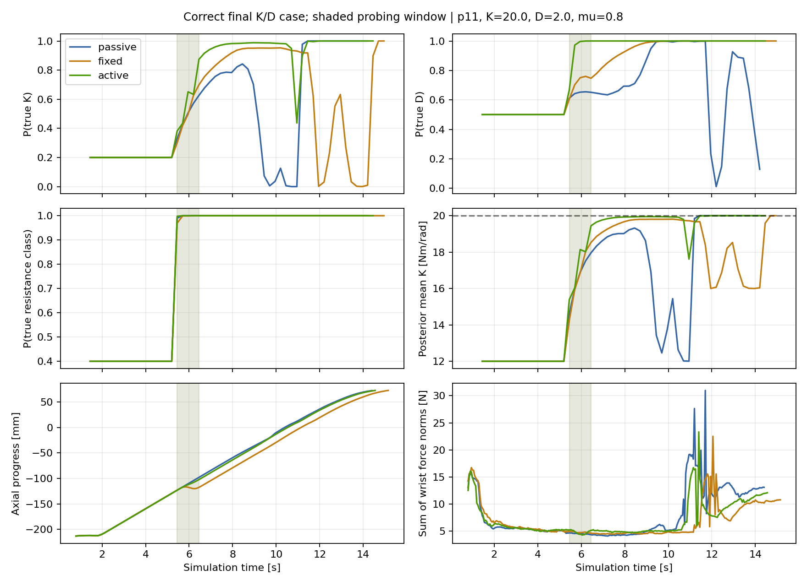
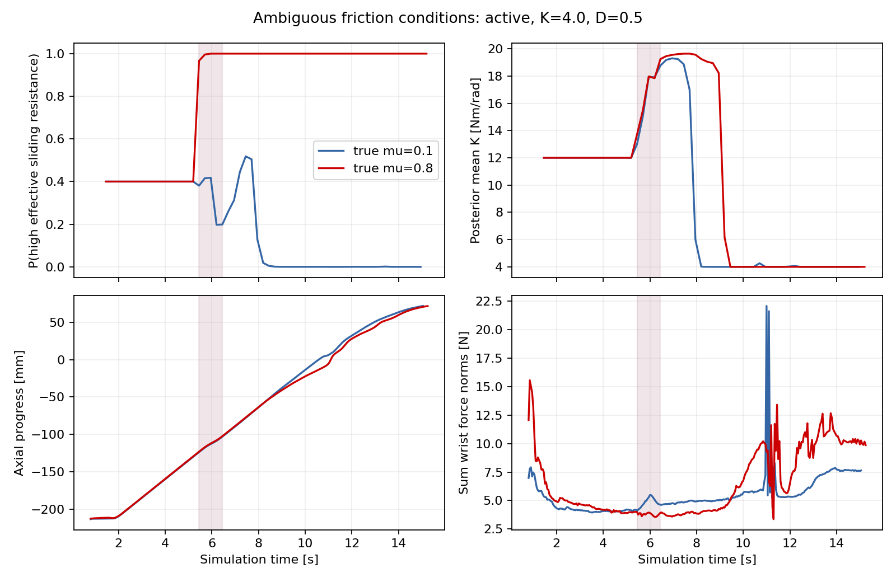
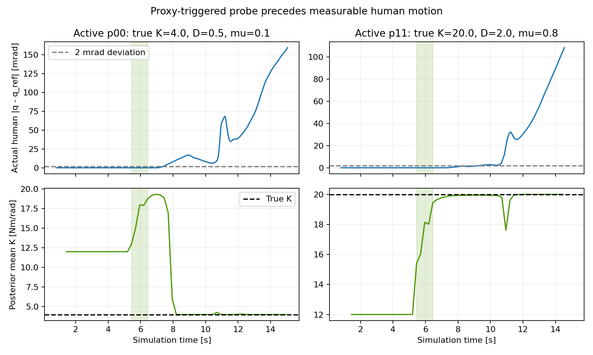

# DynaDress C2：在线联合辨识与任务内主动探测

**结果：冻结模型的 50 假设后验、任务内选动作和 36 条原生配对轨迹已经跑通，36/36 达到既有穿袖几何完成条件。主动组全部选择滚转／左右差动：p11 的探测后 P(真实 K,D) 为 0.874，被动组为 0.349；但全体只有 2/12 个工况改善此项，最终 K/D 同时辨对数为主动 6/12、被动 8/12、固定回撤 9/12。尚不能宣布主动探测可靠辨清人体阻抗。** 探测后真实滑动阻力类别的平均概率为主动 0.737、被动 0.666，最终类别正确数为主动 11/12、被动 9/12、固定 12/12。下面保留正面结果与反例。

**重要限制：探测代理在 5.45s 触发，但整段人体几乎不动。** 模型仍把后验推向高 K、高 D，因此高刚度案例的正确收缩不能独立证明人体被有效激励。C3 可以直接复用 `JointBelief`、`FrozenPredictor.rollout`、`OnlineIdentifier` 和独立 `arm_landmarks/axial_progress`；不应直接把当前熵分数当作可靠的规划收益。

## 1. 版本、环境与范围

- GitHub 分支：`codex/dynadress-c2`；从任务指定的 `8cb2b3be62571629b0834aada8bf0255e0df169d` 创建。最终源码（不含随后报告/证据提交）：`d3893ac70f12b2a94c47ad03335f186e45e5d61f`。
- 原生服务器项目：`/root/gpufree-data/dynadress`。全部主实验 metadata 中的服务器 Git HEAD 为 `2f3864c31e424a69ba7a8d2ed93fd2fb09d7820c`；当时另有未提交的工况/离线工具更新，所以复现应使用本分支及 `C2_SOURCE_MANIFEST.json` 的实际源码哈希，不能仅 checkout 该服务器 HEAD。
- Ubuntu 24.04.5、单张 NVIDIA L40 46068 MiB、驱动 580.126.09；GPU UUID `GPU-325cb85b-7932-ebb0-5aee-d640206e726c`。运行中一次采样显存 4229 MiB，非峰值；数据盘余量约 45 GiB。120 GiB 内存上限沿用 M0 配置。
- Isaac 原生版本 `6.0.1-rc.7+release.42383.32955d8d.gl`，路径 `/root/isaacsim`；PhyRC 固定 `48ffff25c9ff86cda3a2a21c7fc33d9022afa2fc`。没有重装 Docker、驱动、CUDA 或更换 FEM。
- 离线 Torch 2.11.0+cu128、Python 3.12.13、NumPy 2.3.1；原生与离线 wrapper 沿用 M0 的 `torch_library_fix`：显式配置同版 Kit/Python、`omni.isaac.ml_archive/pip_prebundle/torch/lib` 及该归档 NVIDIA 库的加载路径，具体见 `scripts/run_native.sh`、`scripts/m2_model_python.sh`、`docs/NATIVE_SETUP.md`。不以系统 Python 代替此运行环境。
- M2.1 checkpoint `artifacts/m21/model/best.pt` SHA256：`55b895974648a64a98910db5291a87363fe07b985c74ab70cad1ea6c42a89525`。适配器启动时强制检查；模型权重、结构化人体积分、原生状态/动作定义均冻结，未再训练。
- 37 项完整测试通过；另在紧凑审阅工作区复核 10 项 C2 测试通过。测试日志与原生三模式 smoke 标志均已保存。测试通过不代表辨识性能通过。

## 2. 实现与信息边界

| 入口 | 实际实现 |
| --- | --- |
| `dynadress/inference/belief.py` | 50 维联合信念、边缘后验、分组多元 Student-t、Monte Carlo 期望信息增益 |
| `predictor.py` | 冻结 M2.1 批量递推、checkpoint 校验、显式拒绝缺失网络历史 |
| `segments.py` | 21 维摘要、腕载基线、接触前/接触代理/滑动代理分段 |
| `online.py` | 因果观测→短段后验更新→唯一探测机会→真实动作记录 |
| `probing.py` | 平滑推进、回撤重推、暂停推进、滚转差动及候选增量约束 |
| `scripts/m2_collect_episode.py` | `cfg['c2_mode']` 可选分支，调用既有 H1 伺服/IK/保护；原模式执行路径保留 |
| `dynadress/human/geometry.py` | 无 Isaac 依赖的批量人臂 FK 与轴向进度，供 C3 使用 |
| `scripts/c2_{replay,evaluate,diagnose_mu,plots,video,export_review}.py` | 标定/回放、真实日志核对、评分、摩擦诊断、作图、视频及选择性导出 |

网格 K={4,8,12,16,20} Nm/rad、D={0.5,2} Nm·s/rad、μ={0.1,0.2,0.3,0.5,0.8}，K/D 各复制到四关节；已知固定 `q_ref=[0,1,0,0.35]`。联合先验每项 1/50，不独立化人衣后验。滑动阻力类别按 μ≤0.2、μ=0.3、μ≥0.5 聚合，类别先验为 0.4/0.2/0.4，不是三类均匀先验。

网络接收原 109 维状态、30 维动作、8 帧历史。`state[t]` 在积分前观测，`action[t]` 随后发送；短段从 t 到 t+5，观测终点到达才更新，下一段从 t+5 开始。预测评分只使用锚点当时已到达的信念，绝不使用同一目标更新后的后验。每条在线特征和动作均与原始 `samples.jsonl` 重新提取结果核对通过。

摘要为终点 q4/dq4、原生轴向位移变化1、短段内去基线的平均有符号双腕 wrench12。q/dq/relative/load 各自使用 ν=4 的多元 Student-t，组内对角尺度、共享径向重尾，组间相乘；log 权重更新并归一化。5 步与 20 步尺度分别由旧 14 条验证集的 812/197 个非重叠短段 oracle 残差标定：median(|error|)/0.740697 加显式下限。未用新 36 条调整尺度。原 70/14/16 划分不变，split SHA256 为 `c1a24b099fa1418d715ca043b68a2282fcab160d03b4501a90335885af11d759`。

人体 q/dq、机器人及袖口状态来自 solver state，本轮视作可观测，不意味着真机具备相同观测。腕载来自现有 incoming reaction 的 Newton–Euler 补偿净外载估计，保留 N/Nm 与世界坐标、原腕关节原点口径；包含附件和其他接触，不能称为人体专属力或真实 F/T。`solver_contact`、`measured_wrench` 继续缺失；人体保持命令不作为负载。缺失似然通道跳过，缺失完整网络历史则明确不可推理，不填零。

真实 K/D/μ、旧 `probe_a/b/c`、工况名、episode ID 和结果不传入辨识器。真值仅用于环境、验证残差标定、oracle 与评分。固定 μ=0.3 的 10 假设先用旧训练集 e004/e005 回放（旧测试集没有此 μ），再对全部旧 16 测试回放 50 假设；前者只证明流程，后者为开发回归，不是未接触的新测试。

## 3. 主实验与执行约束

12 工况为 K={4,12,20}×D={0.5,2}×μ={0.1,0.8}，每工况 passive/fixed/active 各一回合。36 条共用全新种子 **2026111801**、初始偏移 `[0,0.003,0]` m、原始衣物资产与一次性预抓持初态、25s 总预算、原任务成功条件；没有真值相关探测模板。共享同一随机种子不保证 GPU/FEM 位级一致，探测前的净腕载与后验已有差别；每工况每模式只有一次运行，不能估计重复方差或给显著性结论。

在首个 insert/advance、滑动代理、连续 5 个样本跟踪误差<6mm 的窗口给一次 1s 机会。本批三模式均于 5.4500003s 触发，匹配评分为此前和 6.4500003s，全部实际到达该时间。passive 继续，fixed 回撤重推，active 从四候选选择；低层 IK、关节速度、轨迹跟踪与原终止保护不变。最大推进速度 0.025m/s，滚转 2°、左右差动各 1.8mm；速度与姿态在机会边缘平滑回到普通伺服。候选提案通过增量/IK/关节速度检查，后验使用实际反馈伺服发出的动作。

候选用当前轴构建 20 步提案，对后验采样参数和分组 Student-t 噪声，96 次共同随机数 Monte Carlo，分别估计人臂与衣物边缘熵下降，除 log(10)/log(5) 后相加。相对继续推进增益≤0.01则继续推进。所有假设预测分布相同的零增益测试通过。当前分数仍受冻结模型偏差影响，实际作用不能从分数直接推出。

### 主表：探测机会后与最终辨识

概率/误差是每模式 12 回合算术平均；K/D MAP 各取自己的边缘分布，不取联合 MAP 的分量。完整 36 行的前/后/最终概率、误差、成功/失败、代价见 [episode_metrics.csv](../artifacts/c2/evaluation/episode_metrics.csv)，完整边缘数组见 [metrics.json](../artifacts/c2/evaluation/metrics.json)。

| 模式 | 成功 | P真KD 前→后 | K后验均值绝对误差 前→后 | D误差 前→后 | P真实阻力类别 前→后 | 最终K/D/类别正确数 |
| --- | --- | --- | --- | --- | --- | --- |
| 常规推进 | 12/12 | 0.103→0.099 | 5.993→7.126 | 0.740→0.729 | 0.698→0.666 | 11/12 · 8/12 · 9/12 |
| 固定回撤重推 | 12/12 | 0.096→0.111 | 6.023→7.184 | 0.749→0.749 | 0.725→0.722 | 12/12 · 9/12 · 12/12 |
| 信息增益滚转/差动 | 12/12 | 0.106→0.137 | 5.755→7.676 | 0.723→0.750 | 0.682→0.737 | 11/12 · 6/12 · 11/12 |

主动组探测后 P真K=0.274、P真D=0.500；被动为 0.235/0.514。主动 P真KD 高于被动仅 **2/12** 工况，固定为 5/12；最终 K/D 同时正确分别为被动8、固定9、主动6。主动组探测后人臂熵为0.602 nat，被动为1.483 nat，K误差却更大：收缩不代表辨识正确。

| 工况 K,D,μ | P真KD 后：被动/固定/主动 | P真实阻力类别 后：被动/固定/主动 |
| --- | --- | --- |
| p00: 4, 0.5, 0.1 | 0.000 / 0.000 / 0.000 | 0.150 / 0.310 / 0.196 |
| p01: 4, 0.5, 0.8 | 0.000 / 0.000 / 0.000 | 1.000 / 1.000 / 1.000 |
| p02: 4, 2, 0.1 | 0.016 / 0.008 / 0.002 | 0.400 / 0.371 / 0.702 |
| p03: 4, 2, 0.8 | 0.000 / 0.000 / 0.000 | 1.000 / 1.000 / 1.000 |
| p04: 12, 0.5, 0.1 | 0.013 / 0.017 / 0.000 | 0.913 / 0.362 / 0.558 |
| p05: 12, 0.5, 0.8 | 0.000 / 0.003 / 0.000 | 1.000 / 1.000 / 1.000 |
| p06: 12, 2, 0.1 | 0.103 / 0.087 / 0.055 | 0.290 / 0.558 / 0.387 |
| p07: 12, 2, 0.8 | 0.028 / 0.086 / 0.011 | 1.000 / 1.000 / 1.000 |
| p08: 20, 0.5, 0.1 | 0.149 / 0.126 / 0.000 | 0.076 / 0.574 / 0.338 |
| p09: 20, 0.5, 0.8 | 0.140 / 0.177 / 0.000 | 1.000 / 1.000 / 1.000 |
| p10: 20, 2, 0.1 | 0.386 / 0.335 / 0.701 | 0.163 / 0.492 / 0.659 |
| p11: 20, 2, 0.8 | 0.349 / 0.488 / 0.874 | 1.000 / 1.000 / 1.000 |

表中0.000为舍入，不是删除样本或人为置零。没有任务中止或跟踪中断；这不代表所有后验正确。

### 任务代价

| 模式 | 平均完成时间 s | 匹配时刻平均轴向进度 mm | 全程双腕力范数积分均值 N·s | 匹配1s窗口积分 N·s | 所有回合单腕20Hz最大峰值 N |
| --- | --- | --- | --- | --- | --- |
| passive | 14.671 | -98.45 | 92.50 | 4.809 | 16.75 |
| fixed | 15.471 | -118.19 | 93.70 | 4.750 | 34.55 |
| active | 14.808 | -102.79 | 86.48 | 4.516 | 19.92 |

全部完成手入、腕入、目标前臂截面三个检查，合计108个目标达到；平均最终进度约72mm。三模式探测实际用时均1s，接触**代理**累计时长均1s，跟踪中断0。净外载积分是 ∫(||F_L||+||F_R||)dt，不是有符号冲量，也不是人体接触力；峰值只是20Hz采样峰值，不是240Hz峰值。上述代价只描述这批轨迹，不作跨随机种子的优劣结论。

## 4. 配对曲线：正确案例与失败案例



p11（K20,D2,μ0.8）主动组探测后 P真KD=0.874，高于被动0.349和固定0.488；最后三属性类别均正确。人臂后验均值更快接近20，但高阻力类别三模式在探测前已接近正确，因此不能将类别判断全归功于这次动作。该图按“主动最终K/D均正确的案例中，匹配时刻P真KD增益最大”选取，规则保存在 `figure_selection.json`。



p00/p01 为同 K4,D0.5、不同 μ 的真实配对，主动探测均使 K先错误升到约19，之后才随真实响应回到4。p00 最终 D误判为2，低阻力类别概率仅0.00879，模型确信中阻力；固定组与被动组此回合的K/D均正确。`ambiguous_pair.png` 另显示 p00 三模式全程比较。混淆案例按主动探测后真实阻力类别概率最小选择，没有隐藏失败辨识。



**本批36条的探测窗口内 max ||q-q_ref|| 为 2.17e-14 rad（按原float32共用参考计算），max ||dq|| 为2.87e-7 rad/s；人体偏移首次超过0.002rad发生在7.45–9.95s，晚于探测结束。** 若用十进制双精度0.35作参考，会额外出现约5.96e-9rad的表示误差，结论相同。现有“进度>-0.125m且关节偏移或去基线腕载较大”的代理由腕载分支提前触发，不能证明该窗口真实激励了上肢。模型将未运动解释为高阻抗，造成过早、过强的收缩。p11的早期“正确”与p00的早期“错误”必须一起理解。

## 5. 预测是否向 oracle 靠近

以下均先在每条完整episode内计算RMSE，再按episode取算术平均；不是将所有帧混池。每个锚点对四种参数方案使用同一已记录实际候选动作序列，比较固定中值(12,1.25,0.3)、仅人体后验、完整后验和已知真值oracle。单位分别为rad、mm、N、Nm，不把力与力矩混算。

### 新36条全程预测

| 方法 | q 0.25s | q 0.5s | 进度mm 0.25/0.5s | 力N 0.25/0.5s | 力矩Nm 0.25/0.5s |
| --- | --- | --- | --- | --- | --- |
| middle | 0.007831 | 0.008001 | 0.673/1.021 | 0.914/0.983 | 0.0520/0.0551 |
| human_only | 0.003221 | 0.004320 | 0.482/0.816 | 0.856/0.907 | 0.0476/0.0508 |
| full | 0.003146 | 0.004164 | 0.475/0.797 | 0.841/0.890 | 0.0473/0.0503 |
| oracle | 0.002231 | 0.003100 | 0.446/0.784 | 0.809/0.859 | 0.0468/0.0496 |

完整后验整体改善相对固定中值的预测，但仍有oracle差距。它包含探测后的全程信息，不能把全部改善归因于唯一一次主动动作。按模式拆分0.25/0.5s的完整后验q误差：被动0.002934/0.004067、固定0.003197/0.003990、主动0.003307/0.004435rad；不同模式有不同实际轨迹，不是等同输入下的动作优劣试验。原始逐回合指标均保留。

### 旧16条测试回归

| 方法 | q 0.25s | q 0.5s | 进度mm 0.25/0.5s | 力N 0.25/0.5s |
| --- | --- | --- | --- | --- |
| middle | 0.005683 | 0.005761 | 0.534/0.775 | 4.091/4.136 |
| human_only | 0.003400 | 0.004697 | 0.454/0.719 | 4.054/4.084 |
| full | 0.003476 | 0.004848 | 0.451/0.719 | 4.038/4.065 |
| oracle | 0.001712 | 0.002180 | 0.398/0.664 | 4.028/4.062 |

旧测试上完整后验的人体预测略差于仅人体版本；腕载/相对运动并非对所有数据都有利。完整旧测试结果见 `artifacts/c2/replay/metrics.json` 与逐episode压缩回放，包括尖峰样本，没有裁掉e088。旧测试曾用于开发与诊断，只作回归；新36条为同参数范围内的新种子轨迹，不是范围外泛化。

## 6. 衣物阻力：实测响应和模型敏感性

`mu_diagnosis.json` 对同K/D/模式、μ0.1/0.8的配对进行1s摘要比较。用各自实测历史做预测，另固定低μ历史与动作，只改变模型μ输入，区分历史携带的信息与模型的直接条件敏感性。下表对18个配对取均值，除数为旧验证残差尺度；是诊断比值，不是物理信噪比或重复实验的统计检验。

| 时窗/通道 | 实测高低μ差异/尺度 RMS | 同历史动作仅改模型μ | 各自历史模型预测差异 |
| --- | --- | --- | --- |
| probe 腕载 | 4.918 | 1.005 | 4.841 |
| late_sliding 腕载 | 5.618 | 1.350 | 5.754 |
| probe 人体q | 0.000 | 0.932 | 0.589 |
| late_sliding 人体q | 13.161 | 6.171 | 14.630 |
| late_sliding 轴向变化 | 1.687 | 0.671 | 1.462 |

腕部净外载的配对实测差异明显大于模型同历史μ干预响应；模型从不同历史中跟上了部分差别，但直接的摩擦条件响应偏弱。探测时人体q的实测差异恰为零，模型却预测非零μ效应，与过早的人体后验偏置相符。净腕载包含衣物附件等作用，不能由此断言已辨清人体接触摩擦。

**下一项应优先学习/校准滑动接触的属性条件响应，同时将人体辨识和探测门控移到确有上肢响应的接触阶段。** 先做少量独立种子的同历史/同动作配对复核，区分μ的作用与GPU/FEM变化；若延后后仍无可区分的人体响应，再改变扰动方向。本轮没有为得到更好数字而修改冻结模型、重调似然或重跑主实验。

## 7. C3 几何接口与精度

```python
from dynadress.human.geometry import arm_landmarks, axial_progress
fk = arm_landmarks(q)                 # q[...,4], shoulder XYZ + elbow Y
wrist, axis = fk['wrist'], fk['forearm_axis']
progress = axial_progress(q, cuff_center)  # (cuff-wrist)·axis, metres
```

默认肩位置(1.1,0,1.8)m、上臂0.30m、前臂0.26m，前臂轴从腕指向肘，支持批量输入。真实36条状态的FK进度一致性RMSE **1.082e-7m**，真实腕位置最大误差 **6.329e-7m**。这是与当前采集几何一致，不是视觉测量精度。

| 方案 | 从预测q/袖口做FK的进度RMSE mm 0.25/0.5s | 原生progress通道RMSE mm 0.25/0.5s |
| --- | --- | --- |
| oracle 模型 | 0.677 / 1.213 | 0.446 / 0.784 |
| 完整后验模型 | 0.767 / 1.317 | 0.475 / 0.797 |
| 阻抗积分＋动作平移先验（真值K/D/μ条件） | 2.857 / 5.101 | 0.744 / 1.336 |

先验在此是几何诊断的已知参数基线，不冒充未知参数控制器。模型独立progress通道与从q/袖口算得的几何进度并不完全一致；C3若用FK评分，必须使用表中对应误差。C2后验回放仍使用冻结原生progress递推，没有偷偷换成FK改指标。

C3 可调用：`JointBelief.weights/summary()` 保留联合相关性；`FrozenPredictor.rollout(history,past_actions,actions,grid,q_ref)` 对同候选动作返回各假设轨迹；`expected_information_gain(...)` 为当前未经校准实际收益的候选评分；`OnlineIdentifier.observe/control/sent` 为现有伺服接入点。尚未实现MPPI、概率集成或神经C2编码器。

## 8. 数据、视频和复现

审阅交付为163个选择性证据文件，归档约11.2MB，最大单个文件约0.4MB；完整36条紧凑序列共10248个控制状态、实际动作与联合/边缘后验均保留。未上传USD/网格大资产、原始FEM高维轨迹或全部RGB帧；原始20Hz solver日志与图像在服务器保留。

| 证据 | 项目内路径 |
| --- | --- |
| 主计划与36配置 | `dynadress/configs/c2_paired/plan.json` 及同目录JSON |
| 主表/全指标 | `artifacts/c2/evaluation/episode_metrics.csv`, `metrics.json` |
| 全部状态与实际动作 | `evaluation/c2_paired_*.npz`, `*_actions.jsonl` |
| 全部后验与候选评分 | `evaluation/*_beliefs.json.gz`，内含selection与各候选两项信息分数 |
| 旧16条/固定μ回放 | `artifacts/c2/replay/`, `replay_fixed_mu/` |
| 5步/20步标定 | `artifacts/c2/calibration/`, `probe_calibration/` |
| 结果图（PNG与PDF） | `evaluation/paired_summary`, `identification_pair`, `ambiguous_pair`, `ambiguous_conditions`, `probe_observability`, `friction_response_diagnosis`, `replay_prediction` |
| 连续原生视频及探测截图 | [active_probe.mp4](../artifacts/c2/video/active_probe.mp4), [active_probe.png](../artifacts/c2/video/active_probe.png) |
| 视频来源 | `artifacts/c2/video/video_receipt.json`：p00_active，新种子2026111801，121帧、8fps；字幕只用当时已到达的后验，错误估计也保留 |
| 测试/smoke/真实运行 | `setup_logs/c2/tests.log`, `review_contract_tests.log`, `smoke_receipt.log`, `paired.log.gz` |
| 评分/诊断/绘图/视频 | `setup_logs/c2/{evaluation,mu_diagnosis,plots,video}.log` |
| 来源与校验 | `docs/C2_SOURCE_MANIFEST.json`, `setup_logs/c2/export_receipt.json` |

原始主数据绝对路径：`/root/gpufree-data/dynadress/artifacts/c2/paired/<episode_id>/`，包括config、metadata、samples、belief、probe_selection、probe_proposals及结果。紧凑NPZ额外保留真实physics_step/control_step/sample_wall_time_ns/simulation_time_s/task_stage，这些仅为记录来源，不作为模型输入。详细字段见 [C2_DATA_SCHEMA.md](C2_DATA_SCHEMA.md)。

实际执行并通过的主要命令（在原生项目根目录；下列展示核心命令，实际日志由阶段重定向保存）：

```bash
cd /root/gpufree-data/dynadress
./scripts/m2_model_python.sh scripts/c2_replay.py --calibrate-only --calibrate
./scripts/m2_model_python.sh scripts/c2_replay.py --calibrate-only --calibration-steps 20 --calibrate
./scripts/m2_model_python.sh scripts/c2_replay.py --fixed-mu .3 --split train --limit 2 --output artifacts/c2/replay_fixed_mu
./scripts/m2_model_python.sh scripts/c2_replay.py
./scripts/m2_model_python.sh -m unittest discover -s tests -v
./scripts/run_native.sh python /root/gpufree-data/dynadress/scripts/m2_collect_episode.py --batch-plan /root/gpufree-data/dynadress/dynadress/configs/c2_smoke_final/plan.json
# 三模式原生smoke实际保存了 C2_THREE_MODE_SMOKE_PASS
./scripts/run_native.sh python /root/gpufree-data/dynadress/scripts/m2_collect_episode.py --batch-plan /root/gpufree-data/dynadress/dynadress/configs/c2_paired/plan.json
./scripts/m2_model_python.sh scripts/c2_evaluate.py
./scripts/m2_model_python.sh scripts/c2_diagnose_mu.py
./scripts/m2_model_python.sh scripts/c2_plots.py
./scripts/m2_model_python.sh scripts/c2_video.py --episode artifacts/c2/paired/c2_paired_p00_active --output artifacts/c2/video
./scripts/m2_model_python.sh scripts/c2_export_review.py
```

`./scripts/c2_run.sh` 封装上述顺序并保存日志，需要完整旧100条序列和原生资产。已有工况文件固定新种子，无需重新生成；`python3 scripts/c2_plan.py` 可重建主配置。审阅包有全部新36条紧凑数据，旧100条完整训练/验证数据仍在服务器；本地只有原审阅样例时，不能声称可独立重做旧验证标定。先将既有输出另存再重跑，固定episode名会复用相同路径。原生wrapper会切工作目录，因此collector与plan使用上面的绝对路径；同一时刻仅一个Kit实例。

## 9. 偏差、保留内容与下一步

最初选的20261119种子与旧M2的20261117..20261216重叠；在完成10条、运行第11条时发现后中断，保留到服务器 `artifacts/c2/seed_overlap_pilot/` 和 `setup_logs/c2/seed_overlap_pilot.log`。随后仅换为全新2026111801并从头完成36条；模型、推断、初态偏移和动作规则不变。上述重叠种子pilot、早期composite似然/1.5s探测smoke、局部工具调试评分均排除主结果，并未混池。最终3条smoke仅验证接入。补充人体未激励指标与图发生在主实验后，仅改离线评分，没有重跑或筛除主数据。

导出核对36条实际物理配置、种子、初始偏移、checkpoint、标定/推断源码、原生运行源码哈希一致；模型源码另与M2.1 manifest逐项匹配。最终归档SHA256：`4310068534e11aee2709a7b7851a5450c5b6ada6802c7b3e7b1700b12b2c1680`。本地校验全部162项文件哈希通过；manifest为第163个文件。实际运行代码由manifest映射，不用尚未提交的报告SHA冒充运行版本。

已完成：冻结模型贝叶斯网格、真实三模式闭环、36条新种子完整数据、旧16条回归、逐回合评分、候选与实际动作/后验记录、主动视频、C3几何接口。尚未通过：可靠的人体主动辨识增益、低阻尼的稳定辨识、全部摩擦工况可靠分类、独立多种子收益验证。没有把这些科学验收项写成成功。

下一轮具体入口：

1. `segments.py`、`online.py`：将人体似然与探测门控从净腕载代理分离，延后至手部/前臂真实响应阶段；使用可观测运动而非truth contact，检验不动段是否应保持人体先验。
2. `structured_world_model.py` 及下一轮训练数据：保留已有效袖口分支，改善接触时相、μ条件滑动响应和等效人体作用；本轮保持冻结不修改。
3. `belief.py` 与新验证集：在新接触阶段检验似然校准、跨短段相关误差与过强收缩，不能用本批数据反复调参再当新测试。
4. `probing.py`：门控修好后再测试更能激励回弹/衰减的方向与持续时长；相同限额和独立新种子复核固定回撤、滚转差动与常规推进。
5. C3可复用几何和预测接口，但在实际信息收益验证前，不将当前EIG作为可靠优化目标；完整受约束MPPI仍留在后续阶段。
