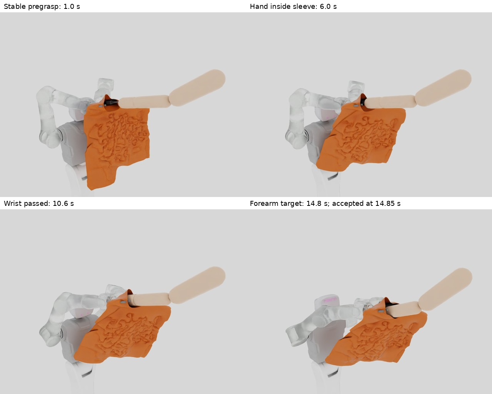
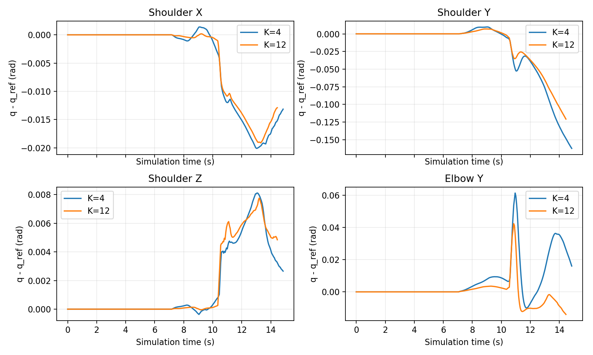

# DynaDress M1.1：第一条完整穿袖轨迹

2026-11-17。**已经实测完成 H1 双臂稳定夹持 → 手部穿入 → 沿前臂推进 → 几何完成。** 使用真实用户 ROKAE 双 AR5 整机资产、原始 PhyRC FEM 和四自由度被动上肢。标称成功运行 `20261117T144712_trajectory02`，模拟时长 14.8500008 秒，已对实际记录复核。后续采集结果见下表。

这次通过的是**预张开、预抓持初态下的 M1.1 任务**。不是桌面自主抓取、摩擦夹持强度验证或完整坐姿人体系统验收；不会用本结果覆盖历史 M1 中这些未完成项。未训练世界模型、辨识网络或任何策略，也没有修改上游 FEM 实现。

## 实际证据

远端根目录 `/root/gpufree-data/dynadress/`，以下 artifact 路径相对该目录；本地同步在 `/home/user/桌面/DynaDress/`。

- 标称连续视频：`artifacts/m11/20261117T144712_trajectory02/trajectory.mp4`；149 帧、800×600、10 Hz，ffprobe 帧数一致，完整解码通过。首帧从初始化开始，末帧 t=14.8 s，结果在 t=14.85 s 达成；没有剪接多次实验或合成成功画面。
- 同步状态/动作：同目录 `samples.jsonl`（298 行、20 Hz）与 `frame_index.jsonl`（RGB 对应真实物理步/时刻）；物理步 240 Hz，所有相邻记录的时间增量与物理步差匹配。
- 成功条件：`result.json`、`validation.json`；最终衣物节点：`cloth_final.npz`。复核脚本不是第二次仿真，检查的是这次运行的原始记录。
- 过程截图：`artifacts/m11/analysis/nominal_sequence.jpg`；响应曲线/数值：`task_responses.png`、`task_responses.pdf`、`analysis.json` 及每个 episode 的紧凑 NPZ。
- 标称执行日志：`setup_logs/m11/08_trajectory02.log`；批量调度：`09_task_batch.log` 及每个条件独立日志。
- 失败视频：`artifacts/m11/20261117T144124_trajectory01/trajectory.mp4`，旧版对齐伺服在稳定夹持下未推进，25 秒实际超时。源码哈希不同，该失败属于修复过程，不作为当前控制器的同策略负样本。



## 标称结果与完成判据

状态转移：机器人独立保持 → 0.75 s 加入衣物/附件 → 1.75 s 稳定夹持完成 → 1.90 s 手部穿入阶段 → 10.55 s 手腕穿过、开始前臂推进 → 14.85 s 完成。没有以超时或固定推进 18 cm 判断成功。

末态袖口位于实际腕部以上 **71.63 mm**，配置目标为 `0.26 m × 0.28 = 72.8 mm`，容差 4 mm。手尖和手腕均已实际越过袖口平面；最终投影截面包含成立，边界最小净距 40.24 mm，大于保守要求 39.41 mm。法向对齐 0.9614，平面残差 6.64 mm。

成功必须连续十个控制采样同时满足：手尖/腕部已穿过且当前前臂截面位于环内、达到目标截面、双侧附件误差 <10 mm、末端误差 <8 mm。记录复核中十项全部为真；十个 20 Hz 采样点实际跨度 **0.45 s**。运行日志 reason 中“0.5 s”按十个控制周期书写不够精确，以物理时间记录和复核结果为准。

标称整个任务中，按同一行 actual pose 与新发送目标重新计算的最大末端误差为左 **3.11 mm**、右 **4.30 mm**；保护逻辑更新新目标前读取的峰值为 2.62/3.42 mm。两者含义不同，均没有通过放宽原有 30 mm 终止阈值绕过问题。附件误差峰值为 1.39/3.67 mm（包含刚加载瞬态）；实际全部机器人关节含手指速度峰值 0.128，转轴单位 rad/s、滑轴单位 m/s，低于配置转轴速度 0.5 rad/s。独立保持误差左 4.67 μm、右 1.35 μm；加载衣物保持峰值约 0.718/0.394 mm。

人体 q_ref 始终 `[0,1.0,0,0.35]`，K=4、D=1。肩 Y 最大偏移约 **0.16237 rad**，四自由度位移并非脚本赋值。仍使用显式 `g(q)+K(q_ref-q)` 与零位置刚度的隐式速度阻尼；人体状态只在初始化设置，之后由 PhysX 动力学积分。

最终节点对手/前臂胶囊做额外几何检查：前臂最小有符号距离 +6.13 mm、无内部节点；手部 2 个节点浅入，最深约 **1.93 mm**，无超过 3 mm 的节点穿入。这只是末态节点检查，不覆盖三角形内部、全过程或完整连续碰撞证明，不能宣称零穿透。衣物有明显皱褶，当前完成判据也不是通用衣物拓扑认证。

## 修复了什么

1. **初始构型。** 肩位置配置为 `[1.1,0,1.8]`，参考肩 Y 从 1.2 改到 1.0 rad，保留 12.7° 上限余量，肘参考 0.35 rad。袖口位置从配置人体的实际手部几何和 80 mm 初始间隔计算，可用 `--offset-y` 设置对齐偏差。腕朝向分别为 L=0°、R=180°（绕工具轴），不强制同向。
2. **全路径 IK 预检。** 少量确定性多初值（48 个/侧），使用解析 Jacobian，检查初始关节余量、可操作度、肘外展以及直到目标前臂截面的 20 个连续路点。标称初态最小关节余量 L=0.100、R=0.158 rad；肘外展约 0.271/0.261 m。它不是全机器人连续碰撞规划。
3. **局部自碰撞和空间。** H1 5/6/7 腕轴共点；原 CAD 网格的非相邻 5/7 腕壳成对排除后，旧构型误差从 31.6 mm 降到约 14.7 mm，进一步选外展构型后降至微米级。仅每侧 5↔7 内部腕壳过滤，机器人其他自碰撞、衣物—人体和衣物—机器人碰撞均保留。没有使用整件衣物对机器人全局过滤；本次也未需要衣物 patch 局部过滤。
4. **真正张开的袖口初态。** 原始细化网格 15878 节点/31344 三角形，选 minimum-X 袖口边界（80 节点）。沿原边界弧长映射为约 66.24 mm 半径开口，远端衣身向下弯折。只写一次初始化节点/零速度；FEM rest mesh、材料、原始厚度/密度/Young 参数不变。这是解析预设，不是假称物理展开快照。
5. **有限面积抓持 patch。** 固定 5 个顶点在细缝处只有约 2 mm 跨度，难以约束开口形状；改为同一连通表面上约 24×25 mm 条带，标称 L=73/R=85 节点，不跨到另一侧袖壁。通过原生 `OmniPhysicsVtxXformAttachment` 绑定到真实腕部刚体。没有逐帧拖节点。
6. **原生附件初始化顺序。** 在无衣物保持通过后动态加入 FEM；完成附件 USD 编辑和 `flush_changes()` 后再写一次节点初态。旧顺序可能在解析附件时丢失节点写入，已保存初始化回读误差。本轮稳定版本不再发生该问题。
7. **测得的袖口闭环。** 松弛后实际环中心与解析初态偏差约 1 cm；现在以实际边界环中心伺服，按实际手/腕/肘计算目标。最大末端速度 25 mm/s，20 Hz 单次位移 ≤1.25 mm，只有跟踪 <6 mm 才推进；双手共用世界平移保持相对构型。停滞时最多两次 15 mm 退让再对齐，异常/丢失抓持/关节近限/IK 不可达均终止。该恢复分支的存在不等于已完成全面故障恢复验收。

### 修复过程的真实失败

| 运行 | 实际失败 |
|---|---|
| `20261117T142657_init01` | 无衣物 0.10 s 左臂误差 31.6 mm，跟踪保护终止 |
| `20261117T142955_init02` | 腕部局部排除后残余约 14.7 mm，独立保持未通过 |
| `20261117T143223_init03` | 外展构型保持通过，但衣物/附件初始化次序导致大偏移，丢失抓持 |
| `init04` / `05_init04.log` | 初始化后的旧映射数值异常，SVD 报错；不作为正常 episode 或成功 |
| `20261117T143807_init05` | 已稳定夹持，但仅细小边界 patch，开口倾斜/包含条件未通过 |
| `20261117T144124_trajectory01` | 面积 patch 稳定，但对齐只追踪预设中心，25 s 未推进；保留失败视频 |
| `20261117T144712_trajectory02` | 实际闭环跟踪边界环，完成全程 |

## 小规模任务采集

| K (Nm/rad) | 初始 Y 偏差 | run id | 时长 (s) | 最终腕上进度 (mm) | 结果 |
|---:|---:|---|---:|---:|---|
| 4 | +0 mm | `20261117T144712_trajectory02` | 14.85 | 71.63 | 通过、记录复核通过 |
| 4 | -5 mm | `20261117T145136_batch_K4_y-0.005` | 14.90 | 71.74 | 通过、记录复核通过 |
| 4 | +5 mm | `20261117T145459_batch_K4_y+0.005` | 14.95 | 71.44 | 通过、记录复核通过 |
| 12 | +0 mm | `20261117T145818_batch_K12_y+0.000` | 14.45 | 71.92 | 通过、记录复核通过 |
| 12 | +5 mm | `20261117T150136_batch_K12_y+0.005` | 14.65 | 72.11 | 通过、记录复核通过 |
| 12 | +20 mm | `20261117T150534_stress_K12_y+0.020` | 3.75 | -212.77 | initial_aperture_or_hold_not_stable |

五个成功 episode（标称加四项批量）全部通过记录复核及视频完整解码。新增 +20 mm 偏差仍能稳定夹持，但手部截面不满足开口包含，3.75 s 在保持阶段结束，未穿入；当次预算为 12 s，**并非运行到预算被截断**。这是同一版本控制器的真实失败样本。当前 hold 门控要求投影手部已被包含才进入 align，因此较大初始偏差可能在可恢复对齐前就被拒绝；后续应将“开口本身可用”和“已对齐人体”分开，不宣称已具备大偏差恢复能力。

K4 标称肩 Y 最大偏移 0.16237 rad；K12 标称对应值 0.12080 rad。两种阻抗的四关节曲线见 `artifacts/m11/analysis/human_4dof_responses.png`/PDF。

该失败视频为 `artifacts/m11/20261117T150534_stress_K12_y+0.020/trajectory.mp4`；新控制器六项数据可供 M2 做有限样例，修复阶段旧控制器数据单独保留。



以上是当前胶囊人体、预抓持资产和少数初态下的环境验证，不是论文统计实验；不同阻抗下仍采用同一确定性反馈控制器，动作会随实际人体响应变化，不能当作严格匹配动作的阻抗辨识实验。

## 实际环境、命令与复位

沿用 M0 原生入口：Ubuntu 24.04、单 L40 46068 MiB、驱动 580.126.09、14 个分配 CPU、120 GiB cgroup 内存；Isaac `/root/isaacsim`，`6.0.1-rc.7+release.42383.32955d8d.gl`。不是 RTX4090，也不宣称该原生构建与锁定 NGC 镜像 digest 等价。PhyRC commit `48ffff25c9ff86cda3a2a21c7fc33d9022afa2fc`，本轮未改 upstream tracked source。Docker 不可用的问题没有重做，未安装新仿真栈。

```bash
cd /root/gpufree-data/dynadress
# 已实际执行：导出同一原版 FEM 的细化边界几何；首次或资产变化后执行。
./scripts/run_native.sh python /root/gpufree-data/dynadress/scripts/m11_prepare_geometry.py
# 已实际执行：标称完整轨迹（当次另加 --seconds 25 --tag trajectory02）。
./scripts/run_native.sh python /root/gpufree-data/dynadress/scripts/m1_coupled_pull.py --seconds 25 --tag nominal
python3 scripts/m11_encode.py artifacts/m11/20261117T144712_trajectory02
python3 scripts/m11_validate.py artifacts/m11/20261117T144712_trajectory02
# 已实际执行：有标称成功证据才开始的四项批量；每项独立日志/新进程。
python3 scripts/m11_batch.py --nominal artifacts/m11/20261117T144712_trajectory02
# 已实际执行：同控制器较大对齐偏差任务，3.75 秒门控失败，非预算截断。
./scripts/run_native.sh python /root/gpufree-data/dynadress/scripts/m1_coupled_pull.py --seconds 12 --stiffness 12 --offset-y .020 --tag stress_K12_y+0.020
# GUI 观察入口沿用同一脚本，当前新版全程证据来自 headless；此命令未重跑。
DISPLAY=:20 ./scripts/run_native.sh python /root/gpufree-data/dynadress/scripts/m1_coupled_pull.py --gui --tag gui
# 每次重新启动就是全场景复位；未实现进程内 reset。
python3 -m unittest discover -s tests -v
```

H1 资产导入/原生环境的首次配置见历史 M1 报告；需要真实用户资产和已下载的原 PhyRC 文件，不能只克隆审阅包就声称可运行。`m11_prepare_geometry.py` 生成的 `assets/h1/generated/m11_garment_geometry.npz` 不上传大资产，能从同一版本原始资产生成；主任务会校验实际三角拓扑与导出数据一致。

`torch_library_fix` 没有改动：`scripts/run_native.sh` 将 Isaac 的 kit Python/kit 动态库优先，随后加入同版 `extsDeprecated/omni.isaac.ml_archive/pip_prebundle/torch/lib` 与 `nvidia/*/lib`；PYTHONPATH 使用原生适配和 upstream sitecustomize。没有系统 CUDA/Conda 的隐式依赖。完整原生安装说明在 `docs/NATIVE_SETUP.md`，历史故障说明在 M1 报告。M0 prepare/smoke/GUI 启动路径保留，本轮没有用重复 smoke 替代任务验证。

资源实测来自两个有限归档窗口，共 379 个约 1 Hz 样本（19 行标称窗口片段＋360 行批量窗口），不是全程峰值保证：GPU 显存峰值 **4127 MiB**，利用率峰值 88%；单 Isaac 进程 RSS 峰值 **6.611 GiB**，活跃样本 CPU 平均 258.5%、峰值 631.9%（100%=一个逻辑核）。原始采样在 `setup_logs/m11/resources_trajectory02.jsonl`、`resources_batch.jsonl`；紧凑汇总为 `artifacts/m11/analysis/resources_summary.json`。结束后 GPU 回到 124 MiB，数据盘剩余约 46 GiB，upstream tracked source 的 Git 状态为空。

## 代码入口、验证及后续边界

| 文件 | 本轮用途 |
|---|---|
| `scripts/m1_coupled_pull.py` | 实际初始化、保持、对齐、穿入、前臂推进/完成和退让；原生附件与同步 episode |
| `dynadress/robots/h1.py` | 解析 Jacobian、多初值 IK/全路径预检、关节限幅 |
| `dynadress/garments/cuff.py` | 原始边界环、一次性张开初态、连通面积 patch、截面包含 |
| `dynadress/configs/m11_sleeve.json` | 人体位置/固定参考/阻抗、独立腕朝向、目标位置、速度/预算/采样 |
| `scripts/m11_prepare_geometry.py` | 同一原始细化资产几何生成及原生附件 schema 查询 |
| `scripts/m11_batch.py` | 标称通过后才开始的小批量任务 |
| `scripts/m11_encode.py` | 连续帧编码、全解码验证 |
| `scripts/m11_analyze.py` / `m11_validate.py` | 实际任务曲线、记录时钟/完成条件/最终节点几何审阅 |
| `tests/test_m11_geometry.py` | 包含/偏离/塌口判据和解析 Jacobian 的有限差分检查 |

六项已有/新增单元测试通过，`py_compile` 和 `git diff --check` 通过；它们不替代本报告列出的真实 PhysX 运行。任务数据说明见 `docs/M11_EPISODES.md`。运行 metadata 保存源代码 SHA256，避免将当前代码版本与修复阶段不同控制器的数据混淆。

下一步改动集中于现有这些文件即可：`m1_coupled_pull.py` 继续优化更大对齐偏差/退让恢复并提取复用的任务 reset；`cuff.py` 加强开口非平面/拓扑与连续穿透评估；`episode.py` 在 M2 需要时加入布料特征/低频全状态和 RGB-D。准确接触力、完整坐姿外观、摩擦夹持验证仍未交付，本轮没有把 traction 或命令力矩伪装成真实接触力。
