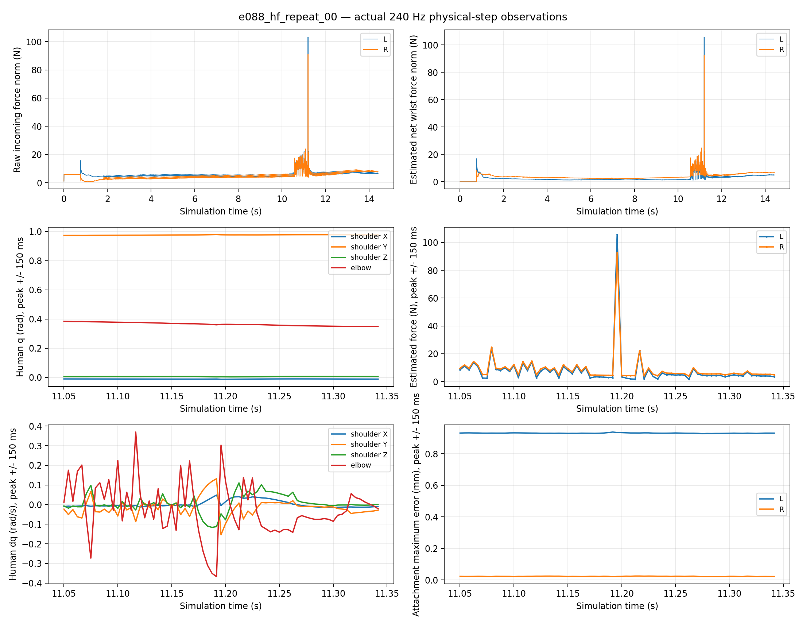

# M2.1：e088 条件的 240 Hz 定向重跑

2026-11-18 在原生 Isaac Sim `6.0.1-rc.7+release.42383.32955d8d.gl`、NVIDIA L40、驱动 `580.126.09` 上实际执行。三个 episode 均到达原有几何完成判据，均记录 3457 个物理采样点，覆盖 14.4 s。它们是新增回归诊断，未加入原始 70/14/16 划分，也未用于模型选择。

## 配置和执行

基于 `dynadress/configs/m2_collection/e088_k4_d0_f4_r0.json`：K=20 Nm/rad、D=0.5 Nm·s/rad、摩擦 0.8、固定 `q_ref=[0,1,0,0.35]`，其余物理参数与原控制器保留。前两次重复原物理配置；第三次仅将初始 Y 偏差增加 2 mm。保留原 seed `20261205`；未人为加入随机噪声。这里复用的是反馈控制器，并非逐条回放原始 episode 的末端指令；接触演化改变后，闭环指令也可能不同。参数组相同，因此新结果不能证明独立参数泛化。

服务器项目根目录 `/root/gpufree-data/dynadress`：

```bash
cd /root/gpufree-data/dynadress
./scripts/run_native.sh python /root/gpufree-data/dynadress/scripts/m21_highfreq.py
./scripts/m2_model_python.sh scripts/m21_analyze_highfreq.py
./scripts/m2_model_python.sh -m unittest discover -s tests -p test_m21_high_frequency.py -v
```

仅生成、审阅配置而不启动 Kit：

```bash
python3 scripts/m21_highfreq.py --prepare-only
```

入口会生成 `dynadress/configs/m21_highfreq/e088_directed/` 下的三个明确配置。若该目录对应的 episode 已完成，collector 会跳过，保留已有证据。复跑请使用 `--plan-name` 指定新的输出组，避免覆盖。

实际日志为 `setup_logs/m21/highfreq.log`，末尾含 `M2_COLLECTION_COMPLETE`。native wrapper 会切换工作目录，仿真入口必须使用上面的绝对路径。一次初始启动因使用相对路径、一次因 wrapper 的 `--allow-root` 参数未转发而未进入场景；入口已修正，正式三次物理运行全部完成。

## 信号和时间口径

`scripts/m2_collect_episode.py --high-frequency` 为可选观察钩子。默认 20 Hz 采集路径保留；没有增加人体/衣物状态写入，没有改变控制周期、驱动、附件和碰撞设置。

每一物理步在下一次积分前读取：

- 原始腕关节 incoming reaction，子关节坐标系，顺序 Fx/Fy/Fz/Tx/Ty/Tz，单位 N/Nm。
- 原有 `wrist_load.py` 的世界坐标系净外载荷估计，以及单独的 Newton–Euler 惯性/重力支撑项。
- 人体 q/dq、当前计算的显式保持力矩命令、重力补偿项、`-D*dq` 的瞬时预期阻尼值。
- 完整袖口边界、开口几何、人体前臂坐标、附件节点和所属刚体的期望节点、最大附件误差、实际腕部位姿、当前末端指令。

当前读取的 solver reaction 对应此前已经求解的物理步；当前记录的保持力矩和新控制目标将用于后续积分。`human.explicit_effort_Nm` 是命令，`expected_damping_Nm` 也不是直接测得的 PhysX 隐式驱动力矩。不能把它们当作人体接触力矩标签。

`WristLoad.read()` 直接调用 `get_link_velocities()`、`get_link_accelerations()` 和 `get_link_incoming_joint_force()`，没有内部有限差分历史。增加读取频率没有更改代码中的加速度估算窗口。原生 solver reaction 与补偿后估计仍分开保存。

每 12 个物理读数形成一个 20 Hz 观察区间 `[t,t+0.05)`：

- `mean_signed_wrench_N_Nm`：有符号分量的均值。
- `mean_force_norm_N`：力模长的均值，与上一项的模长不同。
- `vector_impulse_Ns_Nms`：逐样本有符号 wrench 乘 `1/240 s` 后求和。
- 力模长峰值、该时刻完整 wrench、峰值物理步和时间戳。
- 后处理另从全量物理读数计算每区间独立的力矩模长峰值和时间戳。

这些区间按观察时间及控制步编号分箱，不能解释为全部反力均由该区间刚发出的动作造成。末尾只有一个读数的区间明确标为 `complete=false`，积分时长为 `1/240 s`。原始子关节坐标系分量积分只是该随动坐标系下的分量累计；物理冲量分析使用固定世界坐标系的估计通道。

## 实测结果

| Episode | 变化 | 该次双腕同时峰值 N（L/R） | 峰值时间 s | 峰值所在 20 Hz 区间平均力模长 N（L/R） | 结果 |
| --- | --- | --- | --- | --- | --- |
| e088_hf_repeat_00 | 原条件重复 | 105.661 / 92.669 | 11.195834 | 13.094 / 13.270 | geometric_completion |
| e088_hf_repeat_01 | 原条件重复 | 24.626 / 23.338 | 10.962501 | 7.102 / 7.396 | geometric_completion |
| e088_hf_offset_02 | Y 偏差 +2 mm | 25.125 / 25.345 | 11.012501 | 7.653 / 8.688 | geometric_completion |

repeat_00 的较大事件在 50 N 阈值以上仅占一个 240 Hz 采样点，分辨出的持续时间为 4.167 ms；并非持续 50 ms 的约 100 N 载荷。原始 incoming force 同时为 103.166/91.045 N，惯性/重力支撑项模长约 11.34/11.26 N，因此峰值同时出现在原生反力中，并非仅由补偿减法产生。

该样本双腕世界系力的夹角余弦为 -0.737，主要相向，但并不完全抵消。该物理步人体速度相较前一读数变化为肩 Y -0.286 rad/s、肘 +0.670 rad/s；下一物理步分别部分回落 +0.056/-0.184 rad/s。人体参考姿态没有改变，q/dq 来自动力学求解。这表明腕部短暂事件伴有真实人体速度变化；不能据此将全部腕部载荷等同为传到人体的力。峰值时左右最大附件误差分别 0.934/0.023 mm，未见附件脱离或厘米级跳变。

该事件所在 50 ms 区间，L 的有符号平均力为 `[-5.714,7.897,-0.453] N`，完整区间冲量为 `[-0.2857,0.3949,-0.0227] N·s`；R 冲量为 `[-0.2936,-0.3614,0.0942] N·s`。这些数值保留相向负载的信息，不能用峰值乘 50 ms 代替。

**原 e088 在约 11.2083 s 的 664/638 N 幅度没有在三次重跑中重现。** 因原记录仅为 20 Hz，不能用新增 106 N 事件的 4.167 ms 宽度反推原 664 N 事件的持续时间。原峰值持续时间、具体接触/附件来源、各力传到人体的比例仍未确定。GPU FEM 闭环重复轨迹并非逐点一致，现有证据支持保留尖峰并使用稳健建模，尚不足以宣称已修复物理尖峰根因。



## 证据位置和字段

服务器全量原始文件：

```text
artifacts/m21/highfreq/e088_directed/<episode>/physics_240hz.jsonl
artifacts/m21/highfreq/e088_directed/<episode>/control_20hz_aggregates.jsonl
artifacts/m21/highfreq/e088_directed/<episode>/samples.jsonl
artifacts/m21/highfreq/e088_directed/<episode>/metadata.json
artifacts/m21/highfreq/e088_directed/<episode>/high_frequency_metadata.json
artifacts/m21/highfreq/e088_directed/<episode>/high_frequency_source.json
artifacts/m21/highfreq/e088_directed/<episode>/config.json
artifacts/m21/highfreq/e088_directed/<episode>/result.json
```

审阅包保留 `artifacts/m21/highfreq/environment.json` 和 `analysis/` 的紧凑证据，避免上传完整边界与附件的数百 MB 原始 JSONL：

- `summary.json`：三次运行、峰值、阈值事件、原始数据 SHA256 和峰值区间统计。
- `*_traces.npz`：全量 240 Hz 时间、原始反力、补偿后载荷、支撑项、人体 q/dq、保持力矩命令、袖口中心、进度、附件误差；以及全部 20 Hz 均值、冲量、力/力矩峰值、计数和区间时间。
- `*_peak_excerpt.json`：峰值前后 150 ms 每一物理读数；Git 审阅包选取 repeat00，其余位于服务器/本地；仅为减小审阅体积，将完整袖口边界缩减为 8 点、附件缩减为质心与最大误差。服务器原始文件保留完整数组。
- `*_peak.png` 与 `*_original_window.png`：每次实际峰值及原 e088 时间窗口的曲线；Git 审阅包选取三次峰值图，其余图可由紧凑数据/原始日志重建。

NPZ 里的双腕维始终为 L、R；wrench 最后一维为 Fx/Fy/Fz/Tx/Ty/Tz。`raw_child_N_Nm` 使用 incoming child frame；`estimated_world_N_Nm`、`inertial_support_world_N_Nm`、`control_*world*` 使用世界坐标系，原点为各腕 incoming joint。`human_explicit_Nm` 是上述命令值；`attachment_error_m` 是几何代理。`solver_contact` 的孤立人体接触力矩和 `measured_wrench` 仍不可用，不填零冒充有效测量。

`tests/test_m21_high_frequency.py` 在本地和原生配套 Python 中实际通过：验证有符号抵消、均值模长差异、12 样本积分单位、末样本峰值捕获、末尾不完整区间。该测试仅验证记录/聚合契约；物理运行证据来自上述真实日志和数据。
