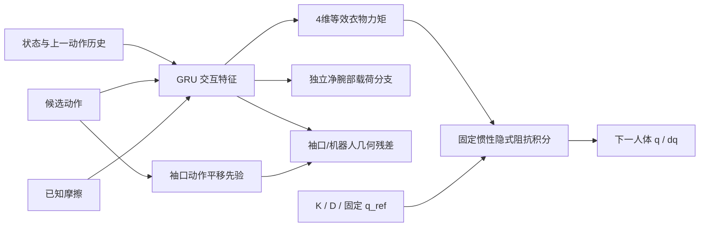
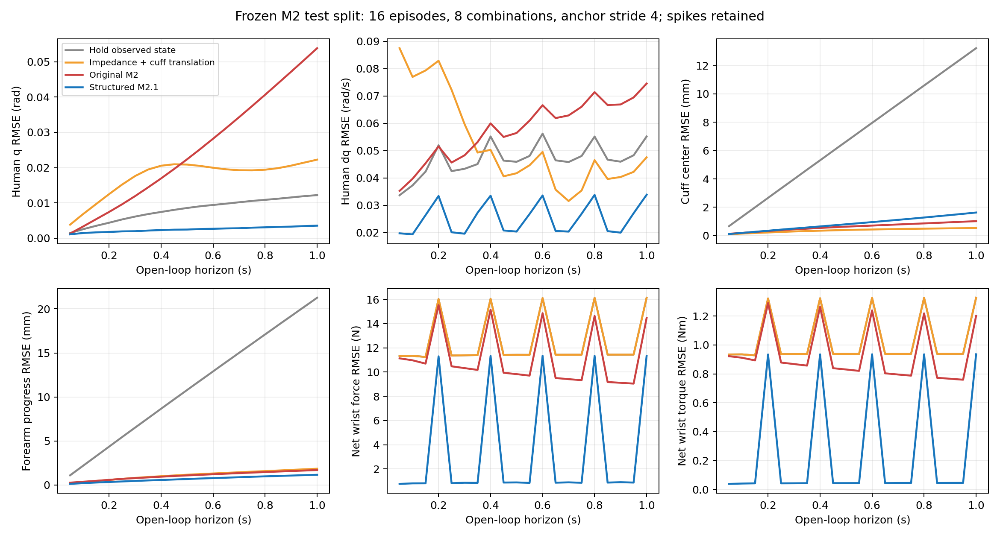
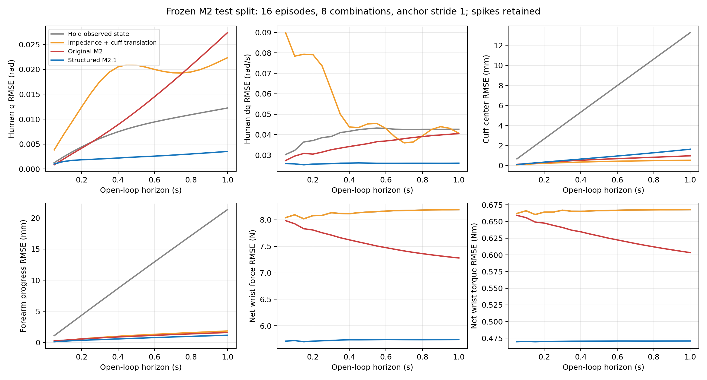
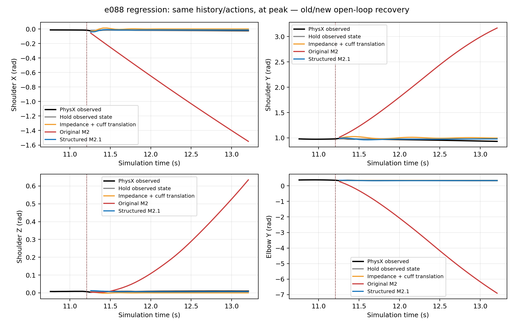
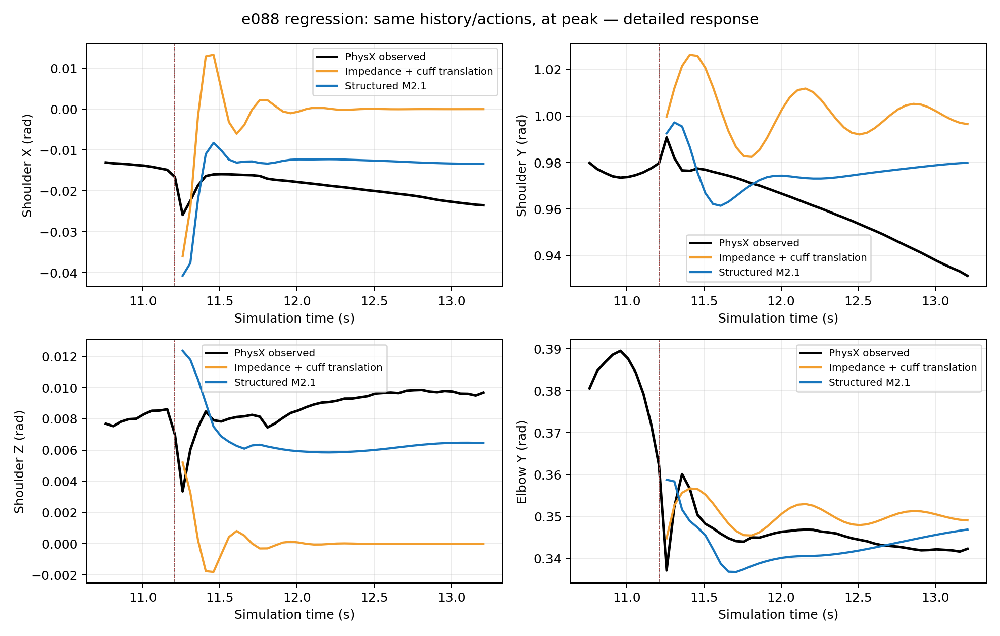
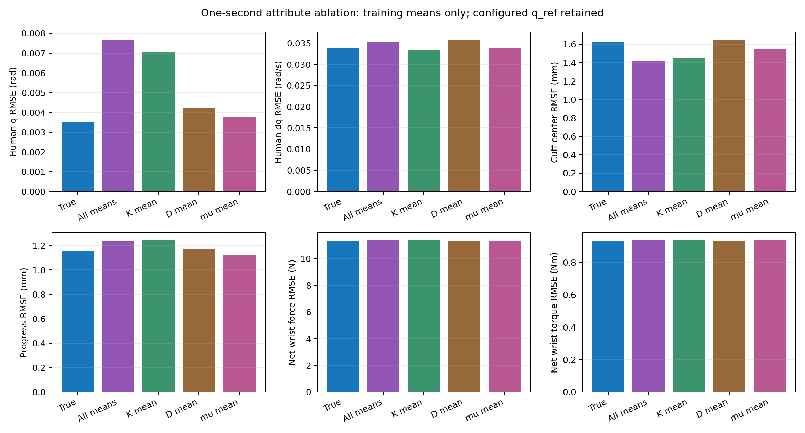
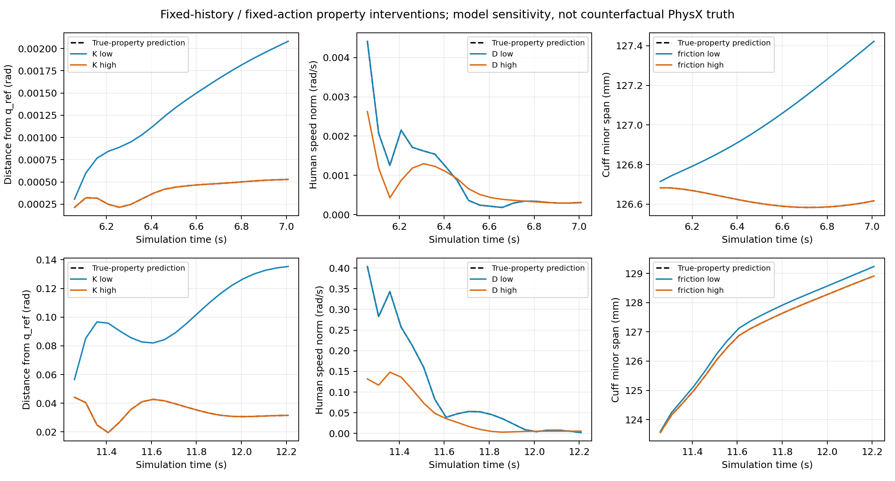

# DynaDress M2.1：显式人体阻抗＋学习等效衣物作用

2026-11-18。已完成实现、真实训练、原测试集评估、逐帧补充评估与三次新增 PhysX/FEM 定向重跑。**人体预测与推进量改善，e088 峰值输入后的持续发散得到抑制；袖口中心/节点仍落后于简单动作平移先验，物理尖峰根因尚未解决。** 本版是确定性预测模型，没有实现概率集成、C2 辨识器或 MPPI。

## 数据、分支与环境

- 交付分支 `codex/dynadress-m2.1`，直接基于 `codex/dynadress-m2-delivery` 的 `163301343152ffd5a1b658d973e379e1d75b1509`；独立原生工作目录使用 `codex/m2.1`。两处 Git 历史不同，源码和证据以 `M21_SOURCE_MANIFEST.json`、训练/评估 receipt 的 SHA256 对齐。
- 完整 100 条原始 episode 保留服务器 `/root/gpufree-data/dynadress/artifacts/m2/episodes/`；本地和服务器均已有完整紧凑数据 `artifacts/m2/dataset/`，共 26465 帧。没有只用 GitHub 的少量示例训练，没有重采整批数据，也没有删除失败或尖峰。
- 原划分严格复用：70/14/16 条 train/validation/test，对应 35/7/8 个互斥 K×D×摩擦组合。split SHA256 为 `c1a24b099fa1418d715ca043b68a2282fcab160d03b4501a90335885af11d759`。所有原始/变换归一化与损失尺度仅拟合训练集，验证集选择 checkpoint。
- Ubuntu 24.04.5，内核 5.15.0-198-generic；单 NVIDIA L40，46068 MiB，驱动 580.126.09，GPU UUID `GPU-325cb85b-7932-ebb0-5aee-d640206e726c`。沿用 `/root/isaacsim` 原生 `6.0.1-rc.7+release.42383.32955d8d.gl`，未重做 Docker、驱动或 FEM。现 GPU UUID 与 M2 报告不同，按本次实测为准。
- 离线模型环境沿用 Torch 2.11.0+cu128、Python 3.12.13、NumPy 2.3.1。原生和模型 wrapper 继续提供 M0 的 `torch_library_fix`（同版 Kit/Python 与归档 Torch/CUDA 动态库），见 `scripts/run_native.sh`、`scripts/m2_model_python.sh`、`docs/NATIVE_SETUP.md`。仿真只启动一个 Kit；离线工具不占仿真锁。

原 M2 测试集和 e088 已参与本轮设计，**本报告的原划分结果是横向比较和回归证据，不是重新获得的未触碰测试集**。新增三次重跑未用于训练或模型选择，但仍是 e088 同参数组，不证明未知参数泛化。

## 实现与物理口径

`dynadress/models/structured_world_model.py` 新增 `StructuredWorldModel`，保留原 `world_model.py` 和 checkpoint 供比较。状态109维、动作30维、条件13维及时间对齐沿用 M2。历史8帧，20 Hz；动作 a_t 作用于当前状态之后，rollout 只用自身预测和相同候选动作，不读未来测量。



人体没有 q/dq 直接残差通道。网络预测 `tau_hat_cloth`，再用同一个动力学积分器统一生成 q/dq。K、D、q_ref 只进入机械方程；摩擦进入共享交互与衣物/接触分支。未来属性估计器可替换同一个已知条件接口，本版没有估计器。

`dynadress/models/impedance.py` 复用关节顺序 `shoulder_x, shoulder_y, shoulder_z, elbow_y`、质量/惯性/关节轴。参考姿态 `[0,1,0,0.35]` 的完整 4×4 惯性矩阵由真实 PhysX `get_mass_matrices()` 读取，保留肩 Y—肘 Y 非对角耦合，最小特征值 0.004119 kg·m²。模型忽略 C 和 M 随姿态的变化，使用12个1/240 s隐式 K/D 子步。无衣物实测、矩阵、推导、限位及误差见 [M21_DYNAMICS.md](M21_DYNAMICS.md)。两个干净回稳案例的1秒 q RMSE 为0.000183/0.000414 rad；触及硬限位的案例为0.004632 rad。

仿真每物理步显式发送 `clip(g(q)+K(q_ref-q), ±[30,30,20,20])` Nm；D 仅通过零位置刚度、零速度目标的隐式驱动实施，未再显式减 D*dq。模块支持 hold 限幅残差和实际关节限位。正式训练使用未限幅仿射路径，精确组合相同12子步，避免大规模自动微分循环：原100条有效20Hz记录均未发现 hold 饱和或撞限，训练集 hold 绝对峰值 `[0.586,7.850,0.309,1.684]` Nm；最小限位余量0.1885 rad。这不是对未记录240Hz状态的保证。最终模型测试输出未做事后裁剪，原stride4所有87280个人体关节预测分量均未越限。超出当前局部范围时，未限幅训练模型不能代表硬限位冲击或饱和动力学。

等效衣物力矩通过下一步与20步 q/dq误差训练，**没有直接接触力矩标签**。4 Nm 的 tanh 输出界是模型正则，不是已标定的接触阈值；它也会吸收固定惯性、忽略 C 等近似的误差，不能解释为唯一真实人体接触作用。人体保持命令未用作接触监督。

腕部输出是独立的12维净外载荷分支，和人体等效作用可共享交互特征但不互相当标签。输入按训练集75%分位尺度作 `asinh`，峰值未裁掉；腕部监督使用变换后、训练标准差定标的 Huber(delta=1)。推理还原 N/Nm。原 `wrist_load.py` 未修改，原始 incoming reaction、惯性/重力补偿及净外载荷分开保留。它们不是孤立衣物—人体接触力或真机F/T；`solver_contact`、`measured_wrench` 继续不可用，未填零。

袖口中心/8节点继续使用双腕平均动作平移先验，进度使用该平移沿袖口法向的投影，再加学习几何残差。机器人状态另作残差预测以支持开放环递推。

训练 seed2101、batch256、GRU96，损失为0.5单步＋0.5二十步，组内归一化MSE加腕部Huber；具体权重见 `artifacts/m21/model/training_config.json`。31轮训练真实耗时203.98s，验证集最佳第11轮，目标值0.18898933。此目标与原M2的损失定义不同，不能直接比较数值。

checkpoint：`artifacts/m21/model/best.pt`，SHA256 `55b895974648a64a98910db5291a87363fe07b985c74ab70cad1ea6c42a89525`。旧 checkpoint 保留，SHA256 `4af7c1c4c31e00ac328424598fd33e66a2d22f94a063f2d3ec68d1e9b22c56f2`。

## 同一候选动作下的原测试集结果

完整16条、8个参数组、1091个原始stride4窗口。下表为各预测时长终点的分量RMSE，保持失败与尖峰，非独立试验均值。原M2所有旧指标原样保留为 `evaluation/m2_original_metrics.json`；本次重算差异严格为0。逐episode/组合结果、宏平均和关节限位统计见 `evaluation/metrics.json`。

| 时长 s | 模型 | 人体 q rad | dq rad/s | 袖口中心 mm | 推进量 mm | 腕力 N | 腕矩 Nm |
| --- | --- | ---: | ---: | ---: | ---: | ---: | ---: |
| 0.25 | 保持预测 | 0.005286 | 0.042477 | 3.327 | 5.440 | 11.371 | 0.9363 |
| 0.25 | 纯阻抗＋袖口平移先验 | 0.015177 | 0.072253 | 0.259 | 0.697 | 11.371 | 0.9363 |
| 0.25 | 原 M2 | 0.009584 | 0.045623 | 0.388 | 0.698 | 10.477 | 0.8784 |
| 0.25 | M2.1 | 0.001899 | 0.020094 | 0.424 | 0.402 | 0.828 | 0.0421 |
| 0.5 | 保持预测 | 0.008541 | 0.045892 | 6.636 | 10.790 | 11.427 | 0.9383 |
| 0.5 | 纯阻抗＋袖口平移先验 | 0.020864 | 0.041705 | 0.397 | 1.167 | 11.427 | 0.9383 |
| 0.5 | 原 M2 | 0.022358 | 0.056437 | 0.631 | 1.086 | 9.831 | 0.8304 |
| 0.5 | M2.1 | 0.002418 | 0.020353 | 0.799 | 0.677 | 0.891 | 0.0436 |
| 1.0 | 保持预测 | 0.012192 | 0.055159 | 13.227 | 21.269 | 16.137 | 1.3270 |
| 1.0 | 纯阻抗＋袖口平移先验 | 0.022256 | 0.047527 | 0.534 | 1.848 | 16.137 | 1.3270 |
| 1.0 | 原 M2 | 0.053890 | 0.074521 | 1.019 | 1.697 | 14.471 | 1.2014 |
| 1.0 | M2.1 | 0.003522 | 0.033817 | 1.628 | 1.158 | 11.340 | 0.9356 |

1秒 q 相对原M2下降约93.5%，也优于保持和零衣物作用的阻抗先验。这支持学习等效作用在当前任务上有用，不能仅凭稳定积分就忽略持续衣物作用。1秒推进量改善约31.8%；**袖口中心1.628mm、节点3.197mm分别落后于原M2的1.019/1.874mm，以及纯平移先验的0.534/0.979mm**。残差并非对所有几何量都有贡献。归一化/稳健负载、损失分组和机械结构同时改变，未做逐项重训练消融，不能将全部收益唯一归因于某一项。



### 尖峰与起点步长的补充核对

原stride4的终点采样与e088单个尖峰存在相位关系：0.25/0.5/1秒终点中，>50N的窗口数分别为0/0/1，因此原图的载荷锯齿不能当作模型自身5Hz振荡。额外使用**全部4337个stride1起点**，各时长都有该尖峰作为目标；没有改动原划分或替换原指标，也没有再选模型。`evaluation_stride1/metrics.json` 的 `target_load_exposure` 保留每个时长的计数。

| 时长 s | 原 M2 q rad | M2.1 q rad | 原 M2 腕力 N | M2.1 腕力 N |
| --- | ---: | ---: | ---: | ---: |
| 0.25 | 0.005241 | 0.001920 | 7.756 | 5.718 |
| 0.5 | 0.011582 | 0.002398 | 7.545 | 5.737 |
| 1.0 | 0.027361 | 0.003508 | 7.280 | 5.741 |

1秒stride1的袖口中心仍为1.630mm（原M2 0.973、先验0.533），推进量1.161mm（原M2 1.606、先验1.849）。载荷变好不表示模型已能提前预测约664N的罕见尖峰；稳健分支主要避免把单帧异常持续外推。尖峰稀少，当前不足以学习其发生规律。



## e088 回归与240 Hz新重跑

原e088在11.208334s的双腕约663.763/637.804N，作为设计回归案例保留。在峰值状态上用同一历史、同一未来动作开放环预测2秒（训练仅1秒）：原M2的四轴整体q RMSE为2.2251rad、72个越限分量；M2.1为0.012975rad、0越限。只看第一秒，分别为0.98309与0.007322rad。峰值后0.2秒重新给历史，两版2秒RMSE为0.007434/0.006519rad；原M2在该较晚起点也未发散，不能概括成所有峰后窗口都失败。

新版峰值起点的2秒末误差仍为0.024994rad，实际持续衣物作用使人体距q_ref约0.07363rad，而新版约0.02516rad：**消除了旧版的持续跑飞，但仍低估后续肩部偏移**，不能说完全复现了恢复过程。细节与旧/新同窗数据见 `e088_regression.json`、`e088_regression_predictions.npz`。




实际新增三次PhysX/FEM episode：两次原K20/D0.5/摩擦0.8重复，一次初始Y偏差+2mm，均用原反馈控制器并真实几何完成；不是原指令逐条回放。每次3457个240Hz采样、14.4秒。记录原始腕反力、补偿载荷、人体q/dq/命令、完整袖口/附件状态；每12读数保存20Hz有符号均值、冲量、峰值和时间。反力是前一步的已求解值，动作将用于后续积分；区间按观察时间分箱。

| 重跑 | 同时峰值 L/R N | 峰值时间 s | 峰值所在区间平均模长 L/R N |
| --- | ---: | ---: | ---: |
| repeat00 | 105.661 / 92.669 | 11.195834 | 13.094 / 13.270 |
| repeat01 | 24.626 / 23.338 | 10.962501 | 7.102 / 7.396 |
| Y+2mm | 25.125 / 25.345 | 11.012501 | 7.653 / 8.688 |

repeat00超过50N仅一个物理读数，分辨持续时间4.167ms；同读数原生反力约103/91N，并伴有肩Y速度变化−0.286rad/s、肘+0.670rad/s，附件误差仍小于1mm。它不是仅补偿算法产生的数值；但腕部合力不等于人体接触作用。**原664/638N幅度没有重现，其原始持续时间和具体接触/附件根因仍未知**，不可用新事件的持续时间代替原事件。详见 [M21_HIGHFREQ.md](M21_HIGHFREQ.md)。

新增运行的20Hz模型评估另存 `evaluation/directed/metrics.json`，3条、186窗口，未并入原测试分数：

| 模型 | 1秒q rad | 袖口中心 mm | 推进量 mm | 腕力 N |
| --- | ---: | ---: | ---: | ---: |
| 保持预测 | 0.008843 | 14.094 | 22.977 | 1.670 |
| 纯阻抗＋袖口平移先验 | 0.021321 | 0.450 | 1.617 | 1.670 |
| 原 M2 | 0.004621 | 0.756 | 2.156 | 0.856 |
| M2.1 | 0.003139 | 1.847 | 0.992 | 1.026 |

人体与推进量改善在这组新运行中仍出现；袖口中心和腕部载荷落后于原M2。240Hz约106N瞬时峰值可能落在20Hz模型帧之间，不能把这组1.026N的模型误差解释为捕获了所有高频峰值。

## K、D、摩擦是否有用

训练集属性均值约K=11.65714、D=1.35714、摩擦0.33714。只替换属性，固定q_ref、历史、候选动作。原stride4测试集1秒结果：

| 条件 | 人体q rad | 袖口中心 mm | 推进量 mm | 腕力 N |
| --- | ---: | ---: | ---: | ---: |
| 真实已知属性 | 0.003522 | 1.628 | 1.158 | 11.340 |
| K/D/摩擦均值 | 0.007681 | 1.416 | 1.239 | 11.373 |
| 仅 K 均值 | 0.007067 | 1.449 | 1.244 | 11.393 |
| 仅 D 均值 | 0.004234 | 1.651 | 1.172 | 11.338 |
| 仅摩擦均值 | 0.003770 | 1.549 | 1.125 | 11.366 |

真实K明显改善人体q，真实D也改善1秒q；D均值在若干短时速度指标更好，不能称所有指标都受益。真实摩擦对q和载荷有小幅帮助，却不改善本批的所有几何量：摩擦均值的推进量1.125mm反而优于真实属性1.158mm。当前证据对摩擦价值是混合的。

额外同历史/动作干预：在e088峰值处将K20换为4，1秒末预测距q_ref由0.03152增至0.13529rad，呈现较弱恢复；D0.5换为2主要改变过渡形状，1秒末速度不严格单调。摩擦0.8换为0.1时，预测推进量由40.55变42.02mm、双腕平均力模长约3.264变3.956N，未呈现可直接解释的单调摩擦定律。`property_interventions.json/.npz` 和曲线保留这些结果。它们只是模型敏感性，**没有对应反事实PhysX真值，不能证明属性已可辨识或接触分解正确**。




## 实际入口与复现

以下入口均已在服务器实际执行，日志在 `setup_logs/m21/`。训练/测试用已有原生wrapper，未要求重新部署。27项M1/M1.1/M2/M2.1测试通过，0失败、0跳过；测试不能代替上述真实物理运行。后续单独评估测试也通过，见 `tests_receipt.json` 和 `evaluation_receipt.json`。

```bash
cd /root/gpufree-data/dynadress
./scripts/run_native.sh python /root/gpufree-data/dynadress/scripts/m21_dynamics_probe.py
./scripts/m2_model_python.sh scripts/m21_dynamics_validate.py
./scripts/m2_model_python.sh scripts/m21_dynamics_audit.py
./scripts/run_native.sh python /root/gpufree-data/dynadress/scripts/m21_highfreq.py
./scripts/m2_model_python.sh scripts/m21_analyze_highfreq.py
./scripts/m2_model_python.sh scripts/m21_train.py --output artifacts/m21/model
./scripts/m2_model_python.sh scripts/m21_evaluate.py --directed-episodes artifacts/m21/highfreq/e088_directed
./scripts/m2_model_python.sh scripts/m21_evaluate.py --split validation --output artifacts/m21/validation_evaluation
./scripts/m2_model_python.sh scripts/m21_evaluate.py --stride 1 --output artifacts/m21/evaluation_stride1
./scripts/m2_model_python.sh scripts/m21_plots.py
./scripts/m2_model_python.sh scripts/m21_plots.py --evaluation artifacts/m21/evaluation_stride1
./scripts/m2_model_python.sh scripts/m21_predict.py --sequence artifacts/m2/dataset/e088_k4_d0_f4_r0.npz --anchor 212 --horizon 40 --output artifacts/m21/example_prediction.npz
./scripts/m2_model_python.sh -m unittest discover -s tests -v
```

`m21_predict.py` 支持 `--actions horizon_x_30.npy` 和 `--condition attributes13.json`，输出物理单位状态、人体q/dq、袖口/进度变化、独立腕部载荷与等效衣物力矩。没有候选文件时使用记录动作，不读取未来状态。schema继续见M2_DATA_SCHEMA和dataset/features.json。

从GitHub审阅包复现训练前，需将服务器的完整 `artifacts/m2/dataset/`（100个NPZ，约12MB，加index/features/split JSON）恢复到项目同名目录；不能只用随包示例。已有SSH权限的机器可用scp整个目录复制，凭据不写进仓库。`m21_train.py` 会拒绝非70/14/16完整划分。若需重新做定向物理运行，用 `m21_highfreq.py --plan-name new_run` 避免覆盖已完成记录。模型训练随机种子固定，但未承诺GPU逐位复现。

## 文件与剩余工作

| 文件/路径 | 用途 |
| --- | --- |
| `dynadress/models/impedance.py` | 已知机械动力学与限幅/快路径 |
| `dynadress/models/structured_world_model.py` | GRU、三类输出、训练缩放、候选动作rollout |
| `scripts/m21_train.py` / `m21_evaluate.py` / `m21_predict.py` | 训练、完整episode评估、独立推理 |
| `scripts/m21_plots.py` | 从真实JSON/NPZ渲染曲线 |
| `scripts/m21_dynamics_{probe,validate,audit}.py` | 读取真实惯性、无衣物核对、数据范围审计 |
| `scripts/m21_highfreq.py` / `m21_analyze_highfreq.py` | 三次定向重跑与物理步分析 |
| `scripts/m2_collect_episode.py` / `dynadress/recording/high_frequency.py` | opt-in高频观察钩子与聚合；默认M2路径保留 |
| `artifacts/m21/model/` | checkpoint、训练配置和学习曲线 |
| `artifacts/m21/evaluation/` / `evaluation_stride1/` | 原指标、逐帧补充、回归与属性分析 |
| `artifacts/m21/highfreq/` / `dynamics/` | 原生实测、紧凑240Hz轨迹、响应曲线 |
| `docs/M21_SOURCE_MANIFEST.json` | 关键源码、数据索引、checkpoint与交付证据哈希 |

重要未解决项：袖口中心/节点残差优于先验的证据不足；2秒持续接触人体偏移仍有低估；原664N物理峰值的具体来源未隔离；没有直接人体接触力矩或真实F/T标签；摩擦干预不具备已验证的因果解释。本轮已完成确定性训练与评估交付，不据此标记辨识/控制研究阶段通过。

下一轮代码修改优先仍为 `structured_world_model.py` 中几何残差的约束与一致性、`m21_train.py` 中几何/人体损失取舍，以及 `wrist_load.py`/高频钩子处的接触来源隔离。应保留本版checkpoint和评估，不用修改测试或裁掉尖峰制造改进。

核读 `sisl/mechamodlearn` 的 `models.py`（commit `ed514b5d1193ce546b0221ba9222b0228d6c319a`）中惯性矩阵与广义作用分开建模的接口；本版固定实测 M，没有复制其学习惯性模块。

设计参考：[Structured Mechanical Models](https://proceedings.mlr.press/v120/gupta20a.html) 与 [NeuralSim](https://eric-heiden.com/publication/2021-neuralsim-icra/) 的已知机械结构＋未知项思路；[Deep Haptic MPC 第III节](https://arxiv.org/html/1709.09735v3) 区分机器人端触觉预测与人体作用。本版没有其人体taxel标签，只学习等效广义作用。[CaDM](https://proceedings.mlr.press/v119/lee20g.html) 的属性接口与PETS不确定性仅作为后续参考，没有引入其辨识、集成或规划实现。
