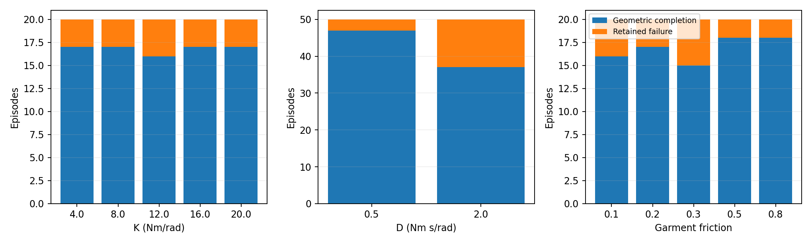
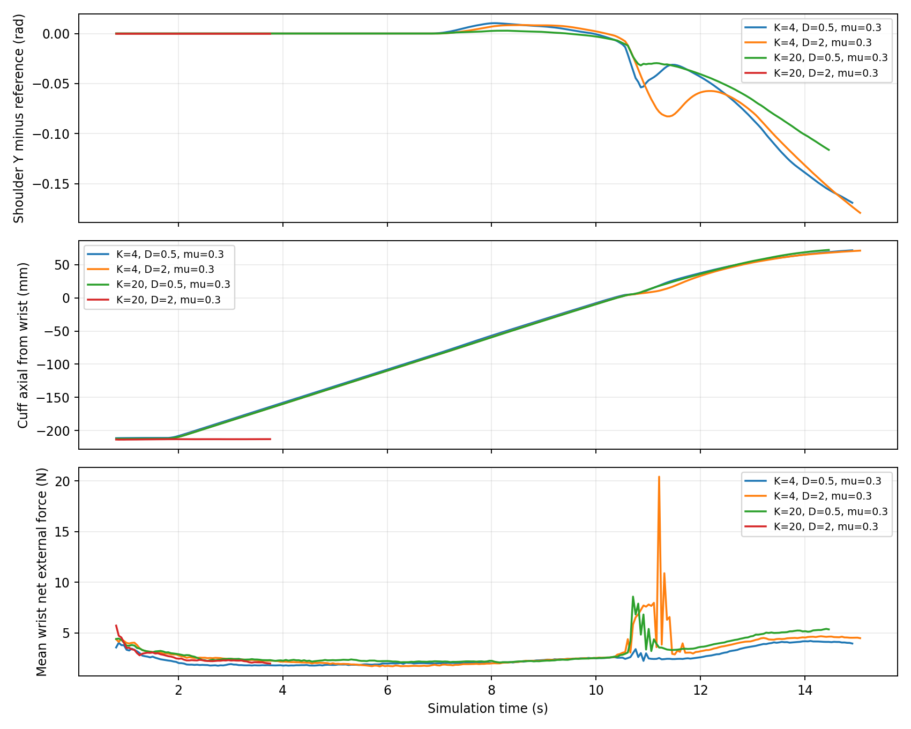
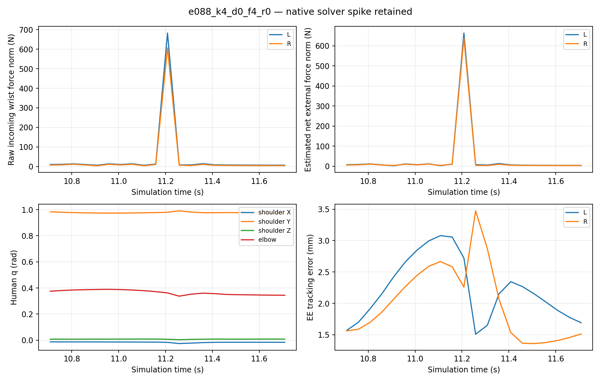
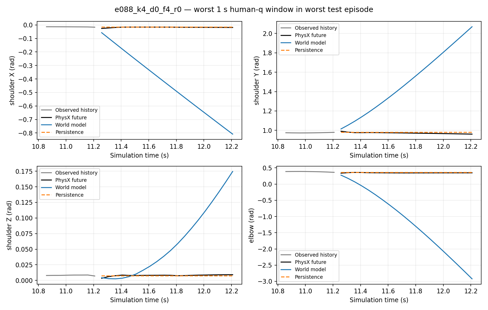
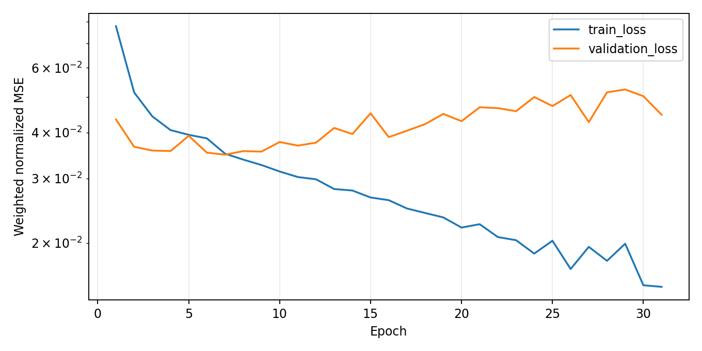
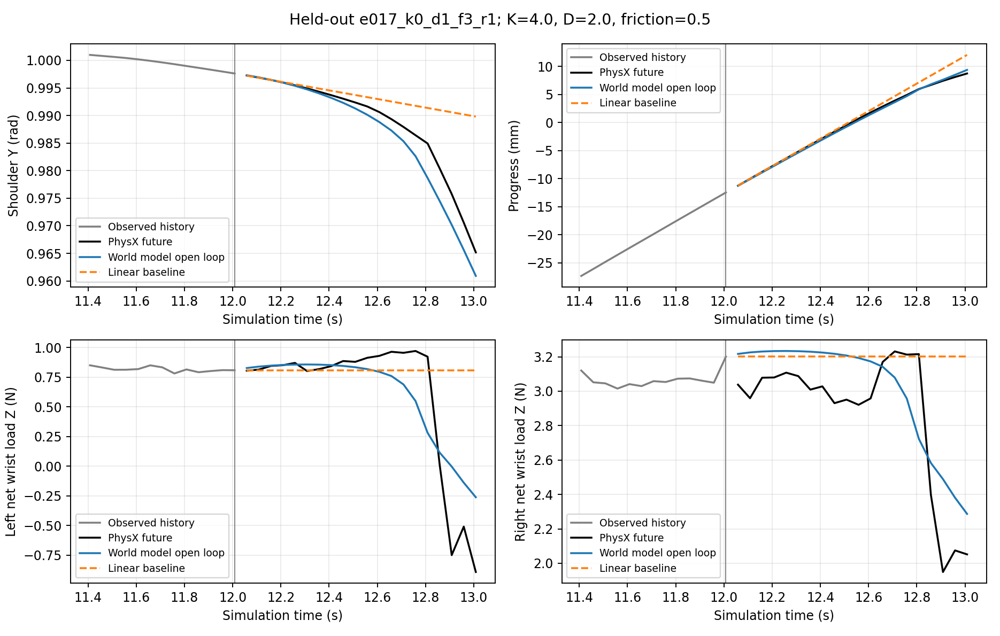
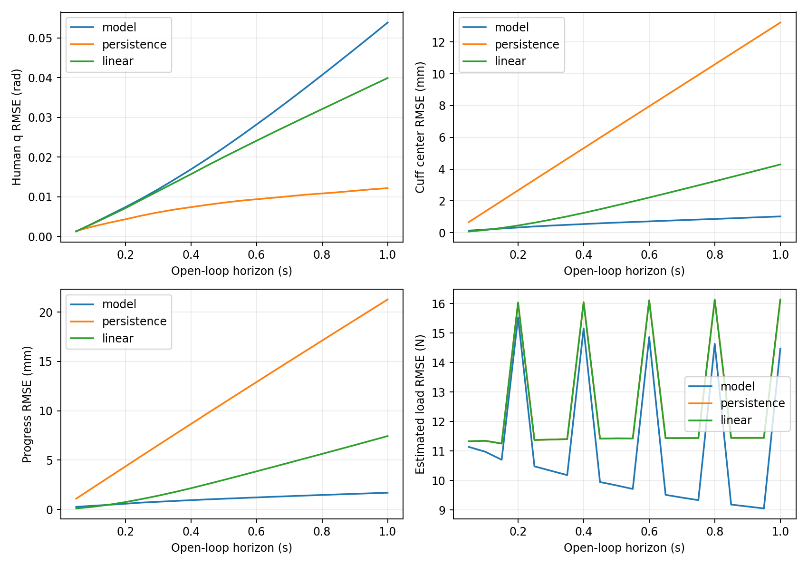

# DynaDress M2：交互数据与首版耦合世界模型

2026-11-17T19:07:09（服务器时区；原始采样时间另存 Unix ns）。本报告只在真实采集、训练和测试全部完成后生成。

**交付：100 条真实 PhysX/FEM episode，84 条几何完成、16 条失败全部保留；已训练动作条件化历史模型，并完成隔离参数组合上的单步与 1 秒递推评估。** 这仍是预张开、原生附件预抓持的简化上肢环境，不是物理夹爪摩擦抓取、完整坐姿人体或已完成属性辨识的系统。

## 数据与任务

服务器根目录 `/root/gpufree-data/dynadress/`；本地同步根目录 `/home/user/桌面/DynaDress/`。下述 artifact 路径均相对根目录。

保留 `scripts/m1_coupled_pull.py` 与 `m11_sleeve.json` 的成功路径，本轮使用独立 `m2_collect_episode.py`。真实 ROKAE H1、固定底盘、肩 3＋肘 1 被动上肢、原始 PhyRC FEM/材料/细化拓扑与附件方式不变。只在每条 episode 初始化设置人体和衣物状态，之后由求解器积分。人体固定 q_ref，显式 `g(q)+K(q_ref-q)`，隐式速度阻尼 D、零位置驱动刚度。

完整独立因子设计：K=[4.0, 8.0, 12.0, 16.0, 20.0] Nm/rad，D=[0.5, 2.0] Nm·s/rad，衣物静/动摩擦系数=[0.1, 0.2, 0.3, 0.5, 0.8]。共 50 个组合，每组合两条动作/初始偏差不同的 episode。摩擦从实际 USD 材料属性回读，而非只写配置。它是衣物材料系数，接触对的有效摩擦还受另一材料及求解器组合规则影响。

初始 xyz 小偏差由固定计划随机种子 20261117 生成；五条设 Y=20 mm 的压力条件。每条实际偏差写入 config。IK 使用旧成功构型温启动并检查完整路径，不通过删除限位检查加速。IK 回退种子固定 11；episode 的 `seed` 是计划记录字段，本批没有额外随机噪声或随机策略，不宣称 GPU 求解逐位确定性。

一半保留基线推进，另一半加入短暂停留、0.5 s 小幅退让、±2° roll 与±2 mm 双臂差动平滑脉冲，三种时间偏移。实际记录的控制采样数：`{'advance': 25419, 'pause': 546, 'retreat': 420, 'roll_differential': 1680}`。原有跟踪、抓持、关节限位和无进展保护保留，失败不删。所有成功重新核算最后十个样本的包含/进度/附件/跟踪条件；实际跨度 0.45 s。

| 终止原因 | 条数 |
|---|---:|
| `geometric_completion` | 84 |
| `time_budget_exhausted` | 1 |
| `initial_aperture_or_hold_not_stable` | 15 |

共 26465 个有效有衣物状态，模拟总时长 1398.30 s，240 Hz 物理、20 Hz 控制与状态记录。袖口每次保存真实 80 节点；完整衣物只存初末态，额外全节点快照默认关闭。仅四条计划样本启用 2 Hz RGB（实际帧数/视频见各自 video_probe），其余数据不录图像，避免无意义占盘。没有补齐完整 RGB-D 或通用 reset 框架。

数据目录 `artifacts/m2/episodes/`；紧凑训练序列 `artifacts/m2/dataset/`；每条 config/metadata/result/原始 JSONL 及材料回读均保留。旧六条 M1.1 只做时钟/缺失字段审计，`artifacts/m2/legacy_audit.json`，没有填零作为负载监督。




响应曲线的对齐偏差与反馈动作不完全匹配，只用于数据检查，不作为严格配对的辨识实验。

## 腕部负载

原始 `solver_state.wrist_reaction` 来自 PhysX `get_link_incoming_joint_force()`，前三项 N、后三项 Nm，incoming joint child frame，原点为 localPos1。实际关节旋转/原点从 USD 读取。该量是求解器关节传递反力，包含自重与运动影响。

`estimated_load` 使用世界坐标、腕关节原点处的 Newton–Euler 子树补偿：对合并 wrist7/工具和两根手指求 `sum m(a-g)` 与 `sum(Iα+ω×Iω+r×m(a-g))`，减去转换后的原始关节反力。实际质量、质心、惯性、速度/加速度来自 PhysX；单根手指 0.04 kg，不能省略。人体保持力矩与 PhyRC traction 都未参与。

实测无衣物静止阶段，各正式 episode 的最大残差：力 3e-06 N、力矩 5e-07 Nm。另用标称实际双腕目标序列做无衣物动态回放，`artifacts/m2/load_validation/`：力分量 RMSE 7.96537e-07 N、力矩分量 RMSE 5.77539e-07 Nm，最大合力 3.58252e-06 N，最大力矩 3.27926e-06 Nm。回放仍由机器人驱动和动力学执行，不逐帧写关节角；没有衣物和人体，验证自重/惯性补偿范围。

这个通道是**净外部载荷估计**，可能包含衣物附件、其他碰撞、模型/数值误差和关节摩擦，不能命名为人体接触力或真机 F/T。`solver_contact` 与 `measured_wrench` 继续明确 `available=false,value=null`。人体保持命令仅在 `commanded_wrench` 中。未用它实现真实力阈值保护，未证明两类阻力已经可以独立辨识。字段、公式和来源详见 [M2_DATA_SCHEMA.md](M2_DATA_SCHEMA.md)。

## 模型、划分与实际预测

109 维紧凑状态、30 维候选动作、13 维独立条件。输入 8 个采样点的人体 q/dq、机器人状态、袖口特征、净腕部载荷与前一动作，另输入当前候选动作及已知 K/D/摩擦/q_ref。未来估计器可替换前九维属性，q_ref 继续来自任务配置；本轮没有训练估计器。

GRU(96)＋残差 MLP；人体/机器人关节使用当前速度积分先验，袖口使用双腕平均平移和沿袖口法向的推进投影，载荷/形状保持先验。训练修正后的下一紧凑状态，包括机器人状态，以便后续递推不需要未来机器人真值。它是运动先验与学习残差，未宣称可微复制完整 FEM/刚体动力学。

**70/14/16 条 episode，分别来自 35/7/8 个互不重叠的参数组合。** 同组合的两条 episode 必在同一分区；归一化只拟合训练集。模型选型和早停只看验证集，最终测试在选型后执行。数据划分、源 JSONL 哈希和字段顺序见 dataset/index.json、split_groups.json、features.json。训练损失同时包含单步与二十步递推，实际训练轮次和最优轮次见 learning_curve.json / checkpoint（最优第 7 轮，验证损失 0.0348073）。

多步预测只在起点提供真实历史，随后递推自身预测状态；候选动作采用记录的后续控制命令。未输入未来真实人体、衣物、机器人或载荷状态。它是给定动作序列的预测评估，不是模型自主闭环控制实验。测试 16 条、8 组、1091 个重叠窗口，RMSE 为各分量合并误差，不将重叠窗口当独立统计试验。

| 预测时域 (s) | 方法 | 人体 q (rad) | 袖口中心 (mm) | 进度 (mm) | 负载力 (N) | 负载力矩 (Nm) |
|---:|---|---:|---:|---:|---:|---:|
| 0.05 | model | 0.001276 | 0.128 | 0.265 | 11.136 | 0.9223 |
| 0.05 | linear | 0.001316 | 0.071 | 0.105 | 11.328 | 0.9342 |
| 0.05 | persistence | 0.001417 | 0.667 | 1.097 | 11.328 | 0.9342 |
| 0.25 | model | 0.009584 | 0.388 | 0.698 | 10.477 | 0.8784 |
| 0.25 | linear | 0.009309 | 0.625 | 1.057 | 11.371 | 0.9363 |
| 0.25 | persistence | 0.005286 | 3.327 | 5.440 | 11.371 | 0.9363 |
| 0.5 | model | 0.022358 | 0.631 | 1.086 | 9.831 | 0.8304 |
| 0.5 | linear | 0.020007 | 1.714 | 2.991 | 11.427 | 0.9383 |
| 0.5 | persistence | 0.008541 | 6.636 | 10.790 | 11.427 | 0.9383 |
| 1.0 | model | 0.053890 | 1.019 | 1.697 | 14.471 | 1.2014 |
| 1.0 | linear | 0.039919 | 4.292 | 7.434 | 16.137 | 1.3270 |
| 1.0 | persistence | 0.012192 | 13.227 | 21.269 | 16.137 | 1.3270 |

接近腕部的几何子集：起点袖口腕上投影 > -50 mm，421 个窗口；这不是基于真实接触力生成的标签。1 s 误差：

| 方法 | 人体 q (rad) | 进度 (mm) | 负载力 (N) |
|---|---:|---:|---:|
| model | 0.086667 | 2.437 | 23.292 |
| linear | 0.064254 | 4.619 | 25.973 |
| persistence | 0.019603 | 20.780 | 25.973 |

正式测试暴露出明确短板：人体 1 s 误差 0.0539 rad，逊于保持预测的 0.0122 rad；不能据此宣称已具备可靠的多步人体动力学预测。负载力 1 s RMSE 14.47 N 也仍较大。`e088_k4_d0_f4_r0` 在 t=11.2083 s 的记录中出现左约 663.76 N、右约 637.80 N 的净腕部峰值，原始求解器反力同样出现尖峰；附近样本为数 N 至十余 N。这个事件没有被删除或裁剪，保留在测试指标中。它可能涉及 FEM/附件/碰撞瞬态，当前未隔离根因，不能作为可信的人体接触力。原始摘录见 `analysis/load_peak_source_excerpt.json`，各条峰值见 `load_extrema.json`。因此本轮完成的是数据与可训练模型基线交付，人体和负载预测的可靠性尚未通过。




完整结果含训练均值属性消融，见 `artifacts/m2/evaluation/metrics.json`。属性消融仅检查已知条件接口的作用，不证明潜变量可辨识。对未优于外推基线的指标，应继续保留外推作为比较，不能一概宣称模型全面更好。





模型 `artifacts/m2/model/best.pt`，SHA256 `4af7c1c4c31e00ac328424598fd33e66a2d22f94a063f2d3ec68d1e9b22c56f2`；学习曲线、归一化、训练/验证组清单与代码哈希均保存。预测示例原始数值与动作另存 evaluation/prediction_example.npz。没有训练世界模型之外的策略、属性辨识网络或 MPPI。

## 实际命令、环境与复现

正式采集、训练、评估的实际命令、退出码和时刻见 `artifacts/m2/completion_receipt.json` / `setup_logs/m2/final_pipeline.json`；采集日志 `setup_logs/m2/collection_serial.log`，正式训练/评估日志 `final_train.log` / `final_evaluate.log`。下列是复现入口；另起单条和 GUI 命令仅供操作，不视为额外已执行实验。

```bash
cd /root/gpufree-data/dynadress
python3 scripts/m2_plan.py
# 一个 Kit 进程，逐条销毁并重建完整 USD 场景；已有完成记录跳过。
python3 scripts/m2_batch.py
# 单条与 GUI 观察入口（GUI 命令本轮未单独重跑）：
./scripts/run_native.sh python /root/gpufree-data/dynadress/scripts/m2_collect_episode.py --config /root/gpufree-data/dynadress/dynadress/configs/m2_pilot.json --tag another_run --no-rgb
# DISPLAY=:20 ./scripts/run_native.sh python /root/gpufree-data/dynadress/scripts/m2_collect_episode.py --config /root/gpufree-data/dynadress/dynadress/configs/m2_pilot.json --gui --tag gui_run
./scripts/m2_model_python.sh scripts/m2_dataset.py
./scripts/m2_model_python.sh scripts/m2_validate_episodes.py
./scripts/m2_model_python.sh scripts/m2_train.py --epochs 100
./scripts/m2_model_python.sh scripts/m2_evaluate.py
./scripts/m2_model_python.sh scripts/m2_predict.py --checkpoint artifacts/m2/model/best.pt --sequence artifacts/m2/dataset/e000_k0_d0_f0_r0.npz --anchor 160 --horizon 20 --output artifacts/m2/example_prediction.npz
```

`m2_predict.py` 也接受候选动作 NPY 与条件 JSON；完整列名见 features.json。Git 审阅包仅保存固定 plan、生成器与少量数据，首次从审阅包运行前先执行 `m2_plan.py` 生成 100 个配置；真实机器人/衣物资产仍依赖 M0/M1 原有准备，未上传大资产。

当前 GPU：NVIDIA L40, GPU-0f2fe019-9da2-92c7-0bd5-edd867d3df1a, 46068 MiB, 580.126.09；CPU 配额 1400000 100000，内存上限 120 GiB；系统/内核 5.15.0-198-generic，Isaac `6.0.1-rc.7+release.42383.32955d8d.gl`，Torch 2.11.0+cu128，Python 3.12.13，NumPy 2.3.1，SciPy 1.17.0。当前 GPU UUID 与历史 M0 不同，按本轮实际探测为准。上游 commit `48ffff25c9ff86cda3a2a21c7fc33d9022afa2fc`，tracked source 保持干净。

沿用原生 Isaac，Docker 未重做。`torch_library_fix` 仍由 run_native.sh 设置同版 Kit Python/kit 动态库、Isaac 归档 torch/lib 与 nvidia/*/lib；模型专用 m2_model_python.sh 复用同版库但不打开 USD 或占用仿真锁。未安装 CUDA/ROS/Conda，也未替换 FEM。环境完整记录 environment.json；不宣称预装 rc 构建与 NGC 镜像 digest 等价。

资源采样 `setup_logs/m2/resources.jsonl`：998 个 10 s 样本，GPU 显存采样峰值 5288 MiB，GPU 平均利用率 83.0%，仿真进程 RSS 采样峰值 8.417 GiB、CPU 采样峰值 130.1%（100%=一核）。GPU 数据含部分离线训练重叠窗口；不是全程瞬时峰值保证。

```text
Filesystem      Size  Used Avail Use% Mounted on
/dev/nvme11n1    49G  1.7G   45G   4% /root/gpufree-data
```

## 修复、限制与交付边界

- 初次多进程 Kit 启动出现卡住，保留启动日志/未完成目录在 `artifacts/m2/startup_failures/`，不算成 100 条交互 episode。改为单 Kit、逐条完整场景重建，正常完成整批。`e001` 的早期有效原型因源码记录字段较少，移到 pilots 并用完整采集器重跑。`e007` 保留了完整溯源的早期等价控制版本，主要区别是单条启动与后续完整场景循环的组织方式；其独立源码哈希在 index 中保留。最终 dataset 是 100 条，各自版本可追溯。
- 负载补偿首次漏掉手指时静止残差约 0.785 N，已修复并通过正式静止样本及动态回放检查；旧 pilot 保留，不进入训练。
- 阶段验证发现短时训练在 1 s 递推漂移；根据验证集确定动作平移先验及 20 步训练，正式测试未用于改结构。
- 本批失败为 15 条初态开口/保持不足及 1 条预算耗尽，具体按上表和 episode/result.json；没有通过放宽成功阈值删除失败。
- 当前数据覆盖较窄、仅 50 个组合/每组两次；初态预抓持，非摩擦抓取；无孤立接触对力；1 s 外更长预测与模型闭环未验证。没有用本轮结果宣称人体/衣物参数已可辨识。
- 本轮不补坐姿外观、通用 reset、完整 RGB-D 或全面穿透分析；未推进这些内容替代数据与模型交付。

已完成：真实数据、独立参数配置、可用但有来源限制的负载、可训练/推理模型、隔离组合评估、曲线及可追溯记录。下一步修改集中于 `dynadress/models/world_model.py`（预测与稳定性）、`features.py`（历史/条件接口）和 `interaction/wrist_load.py`（负载标定/接触分解）；若进入属性辨识阶段，应先检查当前动作下 K/D/摩擦的可辨识性，不能由本报告的预测结果直接推出。
