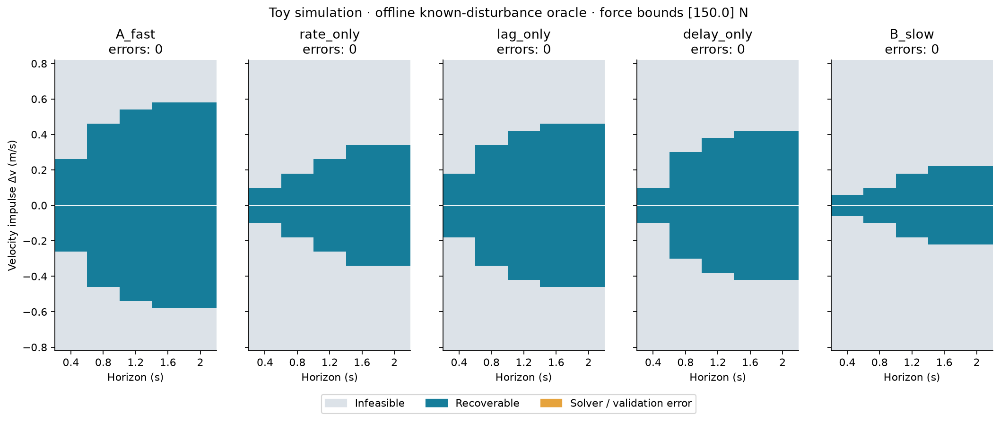
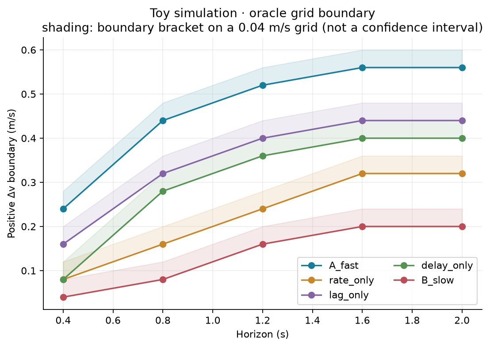
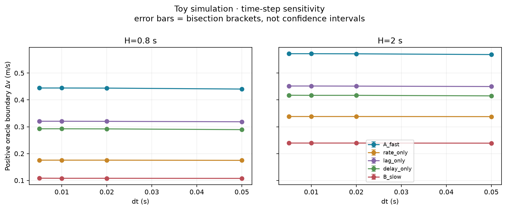

# M0 / EXP0 结果与审阅交接

日期：2026-11-11（Asia/Shanghai）。全部为 **toy model 的 CPU 数值仿真**。

## 1. 实施范围和版本

本轮完成 M0：二维侧向 LIPM、受限辅助执行器、速度/外力两种扰动、离线恢复存在性 LP、因果固定 PD 对照、自动测试、参数扫描、图表与原始数据。没有使用 H1 URDF，没有进入 M1，没有开发 MPC、RL 或 VLA。

- 分支：`exp0/m0`。
- 模型与实验主体提交：`a751a4034053c2f551b2bfe5181045c3248f73e9`。
- 最终数值实现提交：`ae0d139285190b7c3b449db4f82e8bde86c046d5`，补充反馈数值异常记录。
- 绘图排版修正提交：`d77d9c917dd5b81188aa91e55e11a10346845b6b`，仅调整步长图间距和颜色；数值结果没有重算或改写，见 `results/validation/figure_provenance.json`。
- 本报告和正式数据由后续交付提交保存；可用 `git log -1` 查看。数据 metadata 指向上述**实现提交**，避免结果文件自引用自身 commit hash。
- 实现文件：`src/recoverability/{model,actuator,disturbance,solver,feedback,metrics,experiment,plots,__main__}.py`；`tests/`；`configs/exp0.yaml`；`scripts/validate_exp0.py`。
- 完整实现 diff：[`M0_IMPLEMENTATION.patch`](../results/diagnostics/M0_IMPLEMENTATION.patch)。原交接文档从两层上传目录整理到根目录；研究约定原文保留，TASKS 更新完成项。

正式数据的 `implementation_status` 为空，源码 SHA256 已与实现 commit 的文件逐一核对。验证数据运行时存在未提交的结果文件，因此 metadata 的整体 `git_status` 可以非空；这不表示模型实现被改动。

## 2. 实际运行环境与命令

Python 3.12.13，NumPy 2.5.4，SciPy 1.18.1，Matplotlib 3.11.2，PyYAML 6.0.3，pytest 9.2.0；HiGHS IPM。实际依赖及构建后端版本见 [`requirements-exp0.txt`](../requirements-exp0.txt)，机器信息见 [`cpu.json`](../results/diagnostics/cpu.json)。无 CUDA/GPU 运算。

遵循复用本机资产的要求，最终干净 venv 由本机已有 Python 和已有 uv 缓存包离线安装。缓存包在 `/tmp/wheeldog-wheelhouse` 重新封装，实际安装命令为：

```bash
uv venv --python /home/user/.local/share/uv/python/cpython-3.12-linux-x86_64-gnu/bin/python3.12 .venv
uv pip install --python .venv/bin/python --offline --no-index \
  --find-links /tmp/wheeldog-wheelhouse -e '.[test]'
```

该临时 wheelhouse 不是仓库资产，原机器可直接复用现有 `.venv`。其他机器可根据 README 和 requirements 在自己的已有环境/离线包源安装，或使用常规 pip。最初尝试在线安装，用户要求复用资产后停止了下载，最终安装不依赖继续下载。没有下载机器人资产。

正式测试/扫描/验证命令：

```bash
cd /home/user/wheeldog
env -u PYTHONPATH .venv/bin/python -m pytest -q
env -u PYTHONPATH .venv/bin/python -m recoverability \
  --config configs/exp0.yaml --output results/exp0 --seed 0
env -u PYTHONPATH .venv/bin/python scripts/validate_exp0.py \
  --config configs/exp0.yaml --input results/exp0 --output results/validation --seed 0
```

测试实际结果：**41 passed in 1.01 s**，见 [`pytest.log`](../results/diagnostics/pytest.log)。去掉 `PYTHONPATH` 是为了隔离本机 ROS 注入的外部 pytest 插件；最初系统环境和含 ROS 路径的 venv 测试分别在插件加载阶段失败，不能算作项目测试成功。

复现实验请换用新的 output，例如 `results/reproduction`、`results/validation_reproduction`，程序拒绝覆盖非空目录。仅重画已有数据：

```bash
env -u PYTHONPATH .venv/bin/python -m recoverability --output results/exp0 --mode plots
env -u PYTHONPATH .venv/bin/python scripts/validate_exp0.py --output results/validation --plots-only
```

## 3. 模型、假设与恢复定义

详细推导、全部参数单位和时序见 [`EXP0_MODEL.md`](EXP0_MODEL.md)，可配置值见 [`exp0.yaml`](../configs/exp0.yaml)。核心定义：

\[
\dot x=v,\quad \dot v=(g/h)x+(f+d)/m,\quad m=70\,kg,\ h=1\,m,\ CoP=0.
\]

正侧向位移、速度、实际合力 f 和外力 d 同方向。初始静立为 x=v=f=0，历史命令队列为零。主扫描在 t=0 施加 Δv，区别于持续外力脉冲。采样 50 Hz；实际力在节点间线性插值，人体运动对此精确积分。

执行器为采样一阶滞后 + 命令 FIFO + 连续力变化率限制。命令 u 与实际合力 f 不同。所有条件 `|f|,|u|<=150 N`；人为参数如下：

| 抽象条件 | 变化率 R (N/s) | 响应 tau (s) | 命令延迟 (s) |
|---|---:|---:|---:|
| A_fast | 1500 | 0.04 | 0 |
| rate_only | 300 | 0.04 | 0 |
| lag_only | 1500 | 0.16 | 0 |
| delay_only | 1500 | 0.04 | 0.10 |
| B_slow | 300 | 0.16 | 0.10 |

这五组都是**人为抽象执行器条件**，不是 H1 姿态差异。当前 f=0 时，静态力范围余量都为 150 N；该标量完全相同，没有单独区分这些动态条件的能力。

全程要求 `|x|<=0.20 m`、`|v|<=2.0 m/s`；末端要求 `|x_H|<=0.01 m`、`|v_H|<=0.03 m/s`。这些是模型判据，不是临床阈值。后验检查连续区间内的解析极值，不仅检查采样节点。终端箱没有经过不变性验证，也没有约束终端力/待执行队列，所以成功**只表示到 H 的有限时间返回**，不表示 H 以后保持稳定。

LP 经变量/行缩放，由 HiGHS IPM 求解，物理约束没有放宽。`RECOVERABLE` 需经过独立后验检查，`INFEASIBLE` 表示求解器判不可行，`SOLVER_ERROR` 表示未知；不声称附有形式不可行性证书。

固定 PD 对照只读取当前 x,v，自身队列用于命令限幅/限速，不接收未来扰动信息；其 gain 在所有执行器上相同，未做每条件最佳调参。延迟全部位于执行队列，状态测量本身理想无噪声。PD 的 `NOT_RECOVERED` 不是“所有因果控制均不可恢复”。

## 4. 实际样本和恢复边界

主实验 **1,250 个案例**：

| 类别 | 样本数 | 恢复通过 | 不可行 / 该规则失败 | 数值异常 |
|---|---:|---:|---:|---:|
| Oracle 主扫描：5 条件 × 5 H × 41 个正负 Δv | 1025 | 395 | 630 infeasible | 0 |
| Oracle 额外未来脉冲/外力样本 | 10 | 10 | 0 | 0 |
| 因果 PD：H=2 s 扫描及额外样本 | 215 | 65 | 150 NOT_RECOVERED | 0 |

主扫描 Δv 从 -0.8 到 +0.8 m/s，间隔 0.04 m/s。额外验证用四种 dt、两种 H、五种执行器做边界二分，共 **520 次 LP**：238 recoverable、282 infeasible、0 solver_error。合计 1,555 次正式 LP，并没有将确定性重复运行当作独立统计样本。

下面是正 Δv 的 oracle 边界二分区间，dt=0.02 s、H=2 s；低端已恢复，高端已判不可行，每个区间宽 0.000390625 m/s：

| 条件 | 确认可恢复低端 (m/s) | 确认不可行高端 (m/s) | 同 H 的 PD 最大已恢复网格点 (m/s) |
|---|---:|---:|---:|
| A_fast | 0.571484375 | 0.571875000 | 0.56 |
| rate_only | 0.337890625 | 0.338281250 | 0.20 |
| lag_only | 0.451171875 | 0.451562500 | 0.28 |
| delay_only | 0.416796875 | 0.417187500 | 0.12 |
| B_slow | 0.239062500 | 0.239453125 | 0.00 |

PD 一列是间隔 0.04 m/s 的离散网格，**不是**精确控制边界；B 的 0.00 仅表示这一网格和 H 下固定 PD 除零扰动外均未通过，不能推出其在更小扰动或其他控制律下无法恢复。也不能根据这些数值宣称 oracle 优于现实反馈控制——二者信息和目标不同。

完整不同 H 的网格边界在 [`boundaries.csv`](../results/exp0/boundaries.csv)，二分区间在 [`convergence.csv`](../results/validation/convergence.csv)。

### 具体成功和失败案例

- **匹配静态能力的反例**：H=2 s、Δv=+0.36 m/s。A oracle 可恢复，连续峰值 |x|≈0.05685 m，终端 x=0.01 m、v≈0.02936 m/s；B oracle infeasible。对应行 c00222 与 c01206，输入、时域和判据一致，仅抽象动态条件不同。负方向结果一致。
- **存在性不等于该反馈成功**：B，H=2 s、Δv=+0.20 m/s。oracle 可恢复（c01198），峰值 |x|≈0.10445 m；PD 失败（c01199），违反路径限制。失效后继续保存的状态是方程外推诊断，不能视为人体物理预测。
- **两者均失败**：H=2 s、Δv=+0.64 m/s，A/B oracle 都 infeasible。没有绘制不存在的 oracle 轨迹；图例标明 no trajectory，反馈失败曲线另行展示。
- **未来信息差异**：B 在 t=0.2 s 受到 +0.36 m/s 脉冲（c01238/c01239）。oracle 可恢复，并在脉冲前发出非零命令，前 0.2 s 的 |u| 峰值约 105.06 N；PD 同期命令严格为零，最终未恢复。oracle 可以预动作，因此这不是现实因果控制的证据。
- **差异不可见的区域**：在主网格上，所有 H、所有条件在 |Δv|<=0.04 m/s 均可通过 oracle；H=2 s 的 A/B 在 |Δv|>=0.60 m/s 均不可行。多数条件在 H=1.6 与 2 s 的粗网格边界相同；不能将网格分辨率下相同误写成真实边界严格相同。

## 5. 数值检查、耗时和真实失败

41 项自动测试覆盖解析平衡、无辅助解、独立 `solve_ivp` 积分对照、单位/符号、随机连续极值核验、左右镜像、放宽 F/R、延迟队列、观测历史相同下反馈命令相同、力脉冲、原始数据确定性、NaN/异常/非成功求解状态，以及后验拒绝和反馈溢出记录。

正式审计 [`audit.json`](../results/validation/audit.json)：

- 1,025 个主 oracle 样本的方向对称分类差异为 0。
- 本扫描中的能力/时域一致性异常为 0；箱终端下不将时域单调性宣称为普遍定理。
- 1,250 条原始 NPZ 轨迹重放，与 CSV 分类不符为 0。
- 所有已接受 oracle 样本满足连续路径约束，最大 x/v 路径违反均为 0。
- 主扫描接受样本最大动力学残差：x≈1.39e-15 m，v≈4.30e-14 m/s；执行器递推残差≈1.18e-10 N；力增量约束违反≈2.27e-13 N。

步长检查：dt=0.05、0.02、0.01、0.005 s，H=0.8/2 s，逐项保存全部二分查询。dt 从 0.02 缩至 0.005 s 时，所有条件/时域的边界区间中点最大差 0.000390625 m/s；考虑二分区间宽，端点给出的保守差上界为 0.00078125 m/s。这是网格敏感性证据，不是连续执行器的形式收敛证明。

主案例扫描/求解/后验检查约 **10.934 s**（不含绘图和最终文件输出）。Oracle 单案例端到端耗时中位数约 **8.72 ms**、P95 **17.86 ms**、最大 **26.38 ms**；其中包含建模、求解与后验检查，单独求解时间也存 CSV。计时受系统负载影响，不是硬实时承诺。更细步长验证最大案例耗时见 validation summary。

开发时真实遇到的数值失败保留在 [`solver_preflight_errors.csv`](../results/diagnostics/solver_preflight_errors.csv)：三个阶段分别有 14、2、1 次 HiGHS 自动算法选择的 `Not Set` / unscaled 诊断异常，均记录为 `SOLVER_ERROR`。采用量纲缩放和明确 IPM 后，正式主实验和步长验证未出现该异常。没有靠放宽 F、R、状态界限或终端容差来改写结果。故障注入测试不是实际实验失败样本，二者分开解释。

仅重画的复现检查确认所有 9 张 PNG 逐字节相同，CSV/NPZ 没有改动，见 [`figure_regeneration.json`](../results/validation/figure_regeneration.json)。PDF 含导出时间元数据，不要求逐字节一致。

## 6. 数据和图表索引

| 交付项 | 路径 |
|---|---|
| 主原始指标 | [`results/exp0/metrics.csv`](../results/exp0/metrics.csv) |
| 主轨迹、逐案例参数、状态、seed、版本 | [`results/exp0/trajectories.npz`](../results/exp0/trajectories.npz) |
| 运行配置和源码哈希 | [`config.yaml`](../results/exp0/config.yaml)、[`metadata.json`](../results/exp0/metadata.json) |
| 所有二分查询轨迹/指标 | [`validation/trajectories.npz`](../results/validation/trajectories.npz)、[`validation/metrics.csv`](../results/validation/metrics.csv) |
| 测试与安装日志 | [`results/diagnostics/`](../results/diagnostics/) |

全部图均由实际 CSV/NPZ 重建，英文标题标注 Toy simulation；每图同时提供 PNG 和 PDF。







其他图：[`因果反馈结果`](../results/exp0/figures/causal_feedback.png)、[`求解状态/耗时`](../results/exp0/figures/solver_diagnostics.png)、[`Δv=0.20 轨迹`](../results/exp0/figures/trajectory_sweep_0.20.png)、[`Δv=0.36 轨迹`](../results/exp0/figures/trajectory_sweep_0.36.png)、[`Δv=0.64 失败轨迹`](../results/exp0/figures/trajectory_sweep_0.64.png)、[`未来脉冲`](../results/exp0/figures/trajectory_future_impulse.png)、[`外力脉冲`](../results/exp0/figures/trajectory_force_pulse.png)。后两类样本单独标明类型，未混入 Δv 扫描。

## 7. 结论等级、Go/No-Go 与验收点

| 证据层级 | 本轮判断 |
|---|---|
| 模型/数值实现 | G0 通过本轮测试与数据审计；不是对模型物理真实性的证明 |
| 抽象现象 | G1 通过：在这个模型及人工参数下，静态力范围相同仍有不同有限时间恢复边界；单独改变 R、tau、delay 均有可分辨影响 |
| H1 现实性 | G2 未验证；没有 URDF/真实力控、时延、接触和底盘稳定性数据 |
| 方法创新/强基线优势 | G3 未验证；未复现 FORTE/NSR，没有新 MPC，也没有与强基线比较 |

结果符合受限响应的已知动力学效应，**不构成论文新颖性证据**。主要剩余限制为固定接触/CoP、恒定高度、无人体自主动策略、理想双向水平合力、采样执行器替身、无模型误差/感知噪声，以及未经验证的不变终端集。不能据此声称 H1 某姿态更好、安全保证、临床适用或防跌倒能力。

下一步最小任务是**审阅本轮模型、代码和原始数据**：重点检查力插值与滞后模型的选择、终端判据、连续路径检查、求解失败分类，以及 oracle/PD 的信息边界。是否使用更严格终端集合、是否继续到 H1 资产审计，均留待用户和研究助手决定。本轮不继续 M1；当前验收无需额外硬件信息。只有用户决定后续开展 M1 时，才需要真实 URDF/mesh 和缺失的执行器/底盘约束资料。
