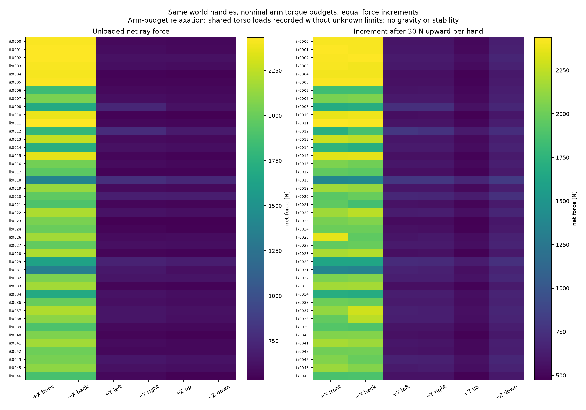
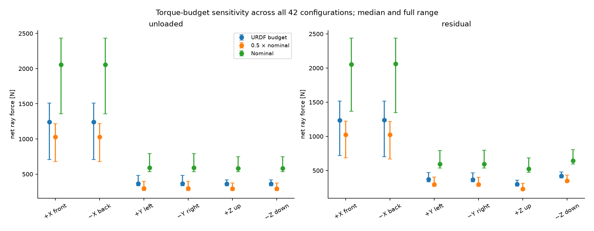
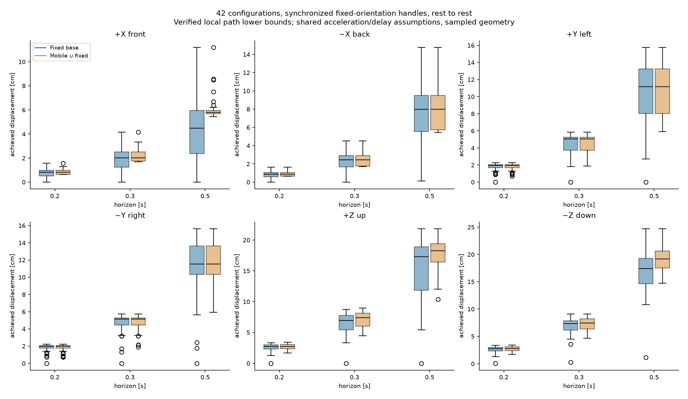
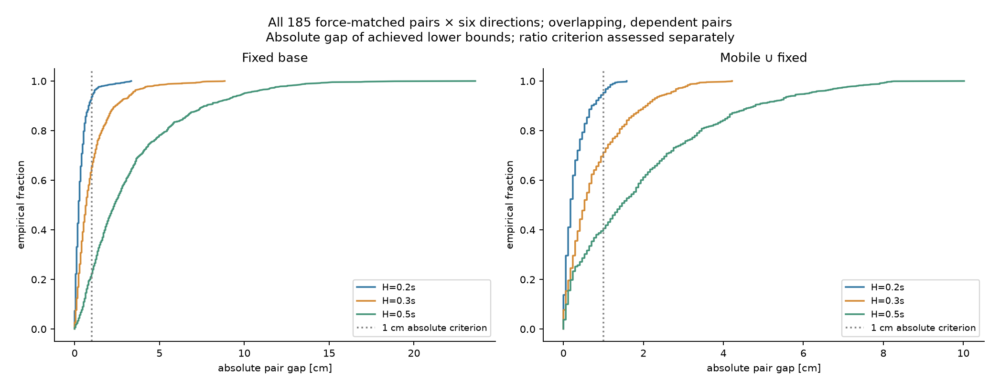
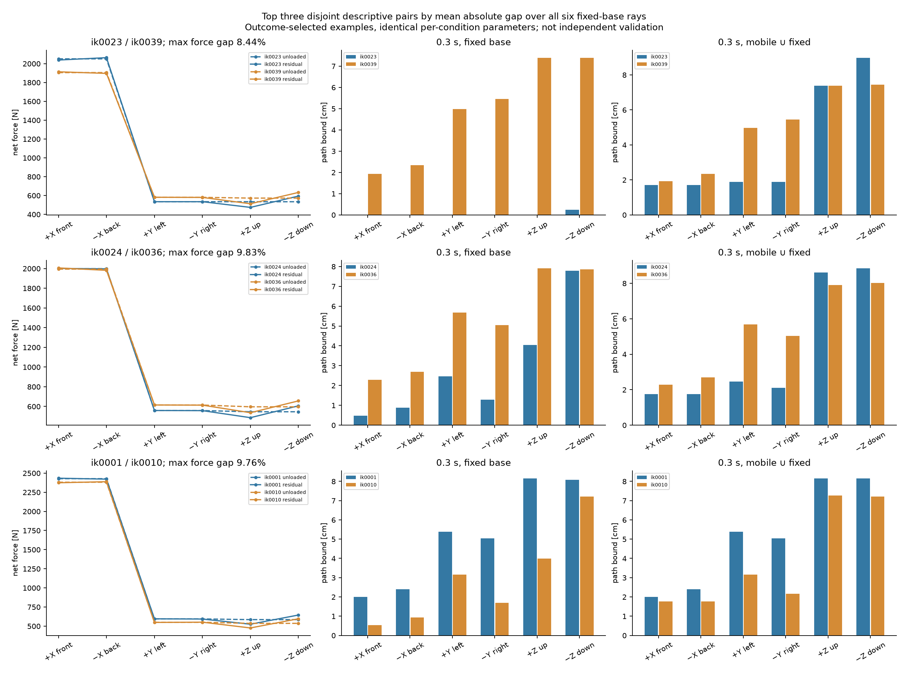
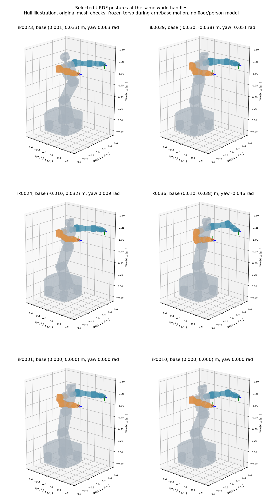
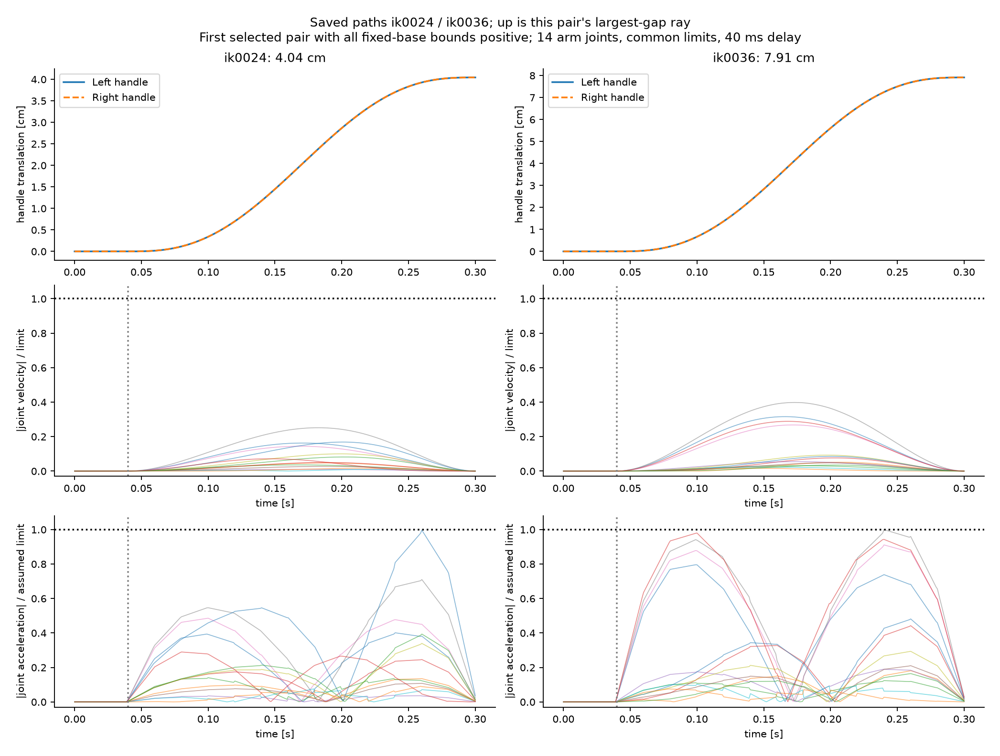
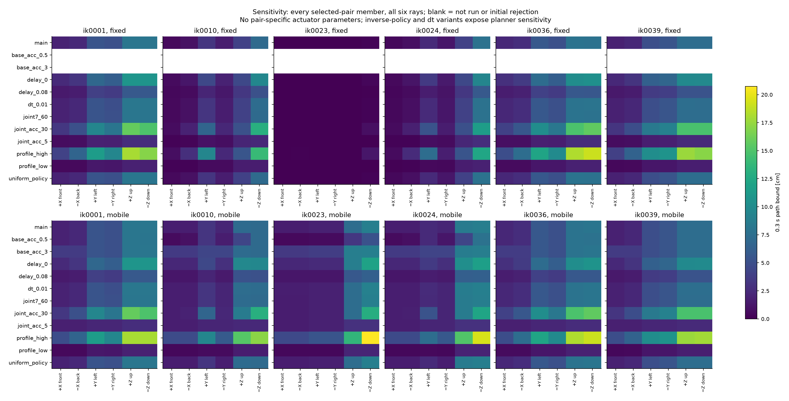

# M1-C 施力预算与有限时间扶手运动：实际结果

## 结论与证据等级

在本轮指定的 H1 URDF 几何、名义臂力矩预算和统一假设运动约束下，**找到了当前六方向施力指标相近、但离线短时协同运动的已达路径下界明显不同的配置**。这支持继续审阅姿态相关未来辅助能力问题；还不能证明配置的全局可达集合排序、真实 H1 动态施力差异或人体恢复优势。

48 个 M1-B 初始候选全部保留，42 个重新通过覆盖参数后的初始几何与任务检查，6 个沿用原始目标超差拒绝。共 1128 个初筛配置对；其中 **185 对**的六空载方向加六任务后剩余方向（12 维）均满足最大对称相对误差 ≤10%。主实验 42×3 窗口×2 底盘模式×6 方向 = **1512** 个案例；另 **720** 个敏感性案例。未扩大 IK 搜索，未人为给不同配置设置不同响应参数。

185 对中，**114 对**在 H=0.3 s、固定底盘下至少一方向同时达到 ≥1 cm 和 ≥1.25 倍的预配置描述判据。六方向平均绝对差的中位数为 **0.889 cm**。这不是统计显著性；配置对相互重叠，42 样本来自一个固定双扶手任务，不是独立总体抽样。

G0/G1 保留先前限定审阅结论。本轮增加的是 URDF 内几何/名义预算下的机器人相关计算证据，**G2（真实 H1 配置恢复差异）、G3（算法创新与强基线优势）均未验证**。本轮停在 M1-C，未进入 M1-D/MPC/RL/VLA/Flow Matching、真机或人体实验。

## 模型、参数与工程范围

完整方程、单位、坐标、LP 与路径搜索语义见 [M1_CAPABILITY_MODEL.md](M1_CAPABILITY_MODEL.md)，正式任务原文见 [requests/M1_C_TASK.md](requests/M1_C_TASK.md)。核心是 τcontact=JL,pᵀfL+JR,pᵀfR，f 为机器人对人体的世界力；共享上游关节先累加两臂贡献。

几何与关节7局部X轴采用原URDF；角度/速度/名义力矩按本轮负责人给定值独立覆盖，未改原URDF。质量190 kg仅记录，不采用异常约740 kg惯性。默认扶手为法兰单位变换，可配置偏置已做差分测试。全向底盘采用SE(2)、平移上限1.5 m/s。

基准任务每侧向上30 N，合计60 N，是人为测试任务。静力模型仅限制14个臂关节接触补偿力矩，未扣重力与动态惯性，未限制未知躯干力矩、底盘倾覆或轮地作用。理想点接触可推可拉、无接触力矩、增量左右等分。输出是**臂预算松弛集合的六方向净合力增量**，不是实机整机力上限或完整 wrench polytope。

运动时每个候选自身的躯干、轮与非臂关节冻结，14个臂关节可动，移动模式另加世界x/y/yaw。双扶手同步平移、各自朝向不变，从静止出发并回到静止；沿路更新FK/J。nominal：臂加速度15 rad/s²、底盘平移加速度1.5 m/s²、yaw速度0.6 rad/s及加速度1.5 rad/s²、延迟40 ms；均为假设。节点20 ms、位置/角误差阈值各1e-5、表面间隙2 mm。连续样条位置/速度/加速度解析检查，任务位姿/力预算/碰撞采样检查。

局部续接两种逆解策略、粗网格与局部二分搜索得到已验轨迹，**不是全局最大可达性求解器**。移动模式取移动搜索与固定解的并集；原局部移动结果也保存。较小的已达下界、零位移或局部失败均不能证明不存在更好轨迹。

## 当前施力与共享关节负载

42配置×3预算×2任务状态×6方向 =1512次力LP全部OPTIMAL。最大后验力矩越限 2.84e-14 Nm，等式误差 0 N。原始力、全部24个关节补偿力矩与限制关节在 `force_and_instantaneous.json`，CSV在 `force.csv`。

下表为42配置的任务后剩余净射线能力中位数，单位N。只比较名义接触预算，不暗示这些量级可以在机器人上实现。


| 预算 | 前+X | 后−X | 左+Y | 右−Y | 上+Z | 下−Z | 10%匹配对数 |
| --- | --- | --- | --- | --- | --- | --- | --- |
| nominal | 2052.90 | 2059.30 | 592.51 | 592.35 | 523.42 | 643.42 | 185 |
| urdf | 1236.18 | 1237.29 | 368.58 | 367.58 | 302.23 | 422.23 | 134 |
| nominal_half | 1021.87 | 1025.20 | 297.24 | 296.38 | 231.71 | 351.71 | 154 |


基准60 N任务的共享躯干绝对峰值需求为 **54.33 Nm**；所有极限射线中的共享躯干需求最大达 **2972.15 Nm**。这是忽略上游预算可能严重乐观的直接证据，不能将臂预算结果称为双臂整机静力可行集合。原URDF预算与半名义预算会改变匹配对数；主配对始终采用负责人指定名义预算，没有重挑条件来扩大效应。




## 瞬时协同速度

每侧同时满足相同线速度与零角速度，完整12维任务LP。下表是42配置的最小/中位/最大净扶手速度，单位m/s；未考虑从静止加速的时间，不作短时位移替代。关节限位切锥、底盘圆盘近似和退化信息随原始记录保存。

| 方向 | 固定 min / median / max m/s | 移动 min / median / max m/s |
| --- | --- | --- |
| front | 0.002 / 0.710 / 1.138 | 1.504 / 2.328 / 2.762 |
| back | 0.002 / 0.710 / 1.138 | 1.504 / 2.328 / 2.762 |
| left | 0.008 / 1.372 / 1.685 | 2.044 / 3.025 / 3.335 |
| right | 0.008 / 1.372 / 1.685 | 2.044 / 3.025 / 3.335 |
| up | 0.017 / 1.681 / 1.981 | 1.315 / 1.855 / 2.055 |
| down | 0.017 / 1.681 / 1.981 | 1.315 / 1.855 / 2.055 |

## 有限时间全样本结果

全部1512主案例找到按原采样规则验收的路径，其中 **14 个只有零位移**；因此“找到路径”含静止解，不是100%非零移动成功率。无主实验数值异常；局部尝试的拒绝仍全部保存。移动模式756案例中452个采用已有固定路径，防止将不完整移动搜索较差误读为允许底盘后物理能力变差。

以下为42配置已达下界的方向中位数，单位cm，每行顺序前/后/左/右/上/下。它们不是 vmax×H，也不是全局最大位移。


| H s | 底盘 | 前 | 后 | 左 | 右 | 上 | 下 |
| --- | --- | --- | --- | --- | --- | --- | --- |
| 0.2 | 固定 | 0.820 | 0.879 | 1.963 | 1.992 | 2.725 | 2.754 |
| 0.2 | 移动∪固定 | 0.820 | 0.879 | 1.963 | 1.992 | 2.754 | 2.783 |
| 0.3 | 固定 | 2.021 | 2.432 | 5.068 | 5.127 | 6.943 | 7.324 |
| 0.3 | 移动∪固定 | 2.021 | 2.432 | 5.068 | 5.127 | 7.383 | 7.441 |
| 0.5 | 固定 | 4.482 | 7.998 | 11.162 | 11.543 | 17.285 | 17.402 |
| 0.5 | 移动∪固定 | 5.801 | 7.998 | 11.162 | 11.543 | 18.252 | 19.160 |


主实验每案例耗时中位数1.154 s，累计worker时间1895.0 s；4个CPU进程运行，计时受负载影响，不是在线控制速率。没有GPU仿真。最大原采样位置误差6.81e-06 m，角误差3.36e-06 rad。




## 代表配置对与原因

施力配对先于运动计算。随后按H=0.3s固定底盘六方向平均绝对位移差降序，贪心选三个互不重叠对。下面是**观测结果后选出的描述示例**，非独立验证集；完整185对在 `pair_comparisons.json/.csv`，无单方向筛选。位移单位cm，同一单元格按A/B顺序。


| A/B | 最大施力误差 | 前 | 后 | 左 | 右 | 上 | 下 |
| --- | --- | --- | --- | --- | --- | --- | --- |
| ik0023/ik0039 | 8.44% | 0.000/1.934 | 0.000/2.344 | 0.000/4.980 | 0.000/5.449 | 0.000/7.383 | 0.234/7.383 |
| ik0024/ik0036 | 9.83% | 0.469/2.285 | 0.879/2.695 | 2.461/5.684 | 1.289/5.039 | 4.043/7.910 | 7.793/7.852 |
| ik0001/ik0010 | 9.76% | 1.992/0.527 | 2.402/0.938 | 5.391/3.164 | 5.039/1.699 | 8.145/3.984 | 8.086/7.207 |


`ik0023` 的固定底盘双臂任务雅可比最小奇异值约0.000289，`ik0039`约0.102；前者多个方向只找到静止轨迹。该极端例混有近奇异性与局部求解敏感性，不能以0下界断言真实能力为0。

更直接的非零例是 `ik0024 / ik0036`：两者初始臂限位最小余量约0.627/0.973 rad，任务雅可比最小奇异值约0.0348/0.118（混合单位数值，仅作诊断）；向左已达2.461/5.684 cm，向右1.289/5.039 cm。较弱路径常由臂关节4加速度接近假设预算限制，较强路径在这些侧向任务常由关节6限制。上移为4.043/7.910 cm，而下移7.793/7.852 cm几乎相同。移动模式下侧向仍为后者较大，但上移8.613/7.910 cm、下移8.848/8.027 cm，已达下界优劣按方向反转，不能用一个“姿态好坏”标签概括。

从公式看，点力只使用Jpᵀ，而保持扶手朝向的运动必须同时满足Jp qdot与Jω qdot；当前力指标相近不要求完整任务雅可比的逆映射、加速度需求及沿途限位相近。不同冗余臂/躯干/底盘初始姿态改变这些映射。这里是符合数据的机制解释，尚未通过逐关节因果消融分离各因素；冻结躯干也限制了全身冗余利用。

第三对 `ik0001 / ik0010` 的底盘初始位姿均为零，仍出现侧向与上移差异，说明本批现象并非只能由不同初始底盘摆放产生。不能据此将差异全部归因于某一个关节或把腕部关节7的轴向假设视作硬件标定结论。






## 当前力能否预测未来运动，底盘如何影响差异

H=0.3s固定底盘下，当前任务后剩余射线力与对应运动下界的Spearman描述相关系数按前/后/左/右/上/下依次为：


-0.378, -0.333, 0.594, 0.558, -0.011, -0.279。


相关符号和强弱随方向变化，当前力无法提供普适未来运动排序。相关性只针对这个任务、候选群和路径搜索，不推断一般机器人/患者总体。

允许底盘后，185对在0.3s的方向平均绝对差（cm）变化如下。多数方向平均差缩小，但单对可能增大或反转，不是普遍定理。底盘移动条件中也允许维持静止，所有能力改善均指所找到路径并集。


| 方向 | 固定平均差cm | 移动平均差cm | 固定实用差异对 | 移动实用差异对 |
| --- | --- | --- | --- | --- |
| front | 0.613 | 0.227 | 32/185 | 0/185 |
| back | 0.628 | 0.380 | 34/185 | 4/185 |
| left | 1.162 | 1.060 | 74/185 | 70/185 |
| right | 1.110 | 0.953 | 67/185 | 66/185 |
| up | 1.611 | 1.168 | 69/185 | 44/185 |
| down | 1.229 | 1.081 | 37/185 | 36/185 |


本任务下侧向及竖直方向的绝对差更大；前后方向在0.3s的平均差较小，底盘参与后进一步减小。此结论依赖固定任务几何、相同的假设加速度/延迟与冻结躯干；“运动方向”不等同于已证明的“人体恢复方向”。

## 敏感性：全部六个代表配置、六方向、固定/移动

共720案例，全部通过原采样路径验收，含静止轨迹；数值异常0。下表为每条件六配置×六方向的平均已达位移，单位cm；非单因素组合档明确标为profile。底盘加速度单因素只改变移动模式。所有A/B使用同一参数。


| 条件 | 固定平均cm | 移动平均cm |
| --- | --- | --- |
| main nominal | 3.519 | 4.574 |
| base_acc_0.5 | — | 3.836 |
| base_acc_3 | — | 5.448 |
| delay_0 | 4.521 | 5.955 |
| delay_0.08 | 2.547 | 3.270 |
| dt_0.01 | 3.538 | 4.608 |
| joint7_60 | 3.519 | 4.574 |
| joint_acc_30 | 6.322 | 7.344 |
| joint_acc_5 | 1.237 | 2.199 |
| profile_high | 7.524 | 10.464 |
| profile_low | 0.879 | 1.090 |
| uniform_policy | 3.519 | 4.543 |


- dt从0.02改0.01s：72个案例最大绝对变化1.172 mm（并非全局收敛证明）。
- 仅uniform策略：固定36案例与主结果完全一致；移动36案例中最大绝对变化4.102 mm。主实现不是完整优化器，仍保留策略依赖。
- 关节7改±60°：72案例结果完全一致，说明这批轨迹没有揭示放宽该限位的收益，不代表真实H1关节7轴向或范围已核实。
- 加速度5/15/30 rad/s²、延迟0/40/80ms及底盘加速度0.5/1.5/3m/s²会改变数量级，故不能把nominal图当作厂家动态性能。
- 低/高组合档同时改变臂/底盘/yaw/延迟，不能从组合差异单独识别某一参数作用。逐对逐向完整结果和排名在 `selected_pair_sensitivity.csv`，包括反向与差异缩小/反转的案例。



## 自动测试、保存后重放与真实失败


自动测试实际输出：**60 passed in 15.06s**。其中原M0/M1的48项保留，M1-C新增12项：参数顺序与单位、原文件不变、虚功符号、共享关节累加、偏置扶手/底盘J差分、解析LP/不可行/无界/预算单调性、协同速度、段内极值、延迟/加速度路径约束、保存路径与移动包含固定解、全向匹配对分析、损坏轨迹检测。

非单位偏置扶手与底盘列的中心差分最大绝对误差 **3.4e-10**（ε=1e-6；线性块m/rad、平移底盘列m/m、角块相应单位，不把混合列误差解释为机械定位精度）。所有初始目标最大位置误差1.84e-08 m、角误差1.1e-07 rad。

2232个发布案例的保存路径逐一重构连续样条与约束；其中代表配置主实验216个，加敏感性720个，共 **936 个**使用每段8分点重查位姿、任务预算与mesh，仍是采样而非连续实体碰撞证明。重复采用固定路径的移动案例也逐例核对；不是2232条互不相同的几何轨迹。

重放失败 **0**；最大连续速度比0.793016597，最大加速度比0.999999401；加密采样位置误差最大6.7e-06 m、角误差最大2.51e-06 rad；最小记录的混合保守/三角表面间隙0.003366 m。重放用时308.1 s，不是物理或因果反馈验证。

主搜索记录23275次运动学拒绝，敏感性11039次；原因可重叠，包括假设加速度/速度越限、关节位置与局部投影步长/残差。它们是候选路径拒绝，不是全局不可行证明。最终路径按当前采样未出现碰撞/姿态/任务力预算拒绝，不代表未测试的路径也不受这些限制。

开发预检曾发生重复`policy`参数导致TypeError；初版插值切线及几何回退策略也经过修正，诊断保留在 `results/m1c/development/`。正式实验在修复后源码提交上从新目录运行，未将开发预检结果混入正式统计。零位移和所有拒绝均保留，没有伪造替代曲线。

冻结检查：原M0 48项与M1 26项SHA256全部一致；没有覆盖原EXP0、原M1数据或原资产。

## 源码、依赖、原始产物与复现

- 分支：`m1/capability-reachability`。
- 正式force/main内核：`593b4006aea8478f05439594152e3b49984ed906`；开始时tracked工作区干净。
- 敏感性阶段来源见 `sensitivity_metadata.json`，内核与主阶段相同；分析/重放来源分别见 `analysis_metadata.json`、`replay_summary.json`。后续提交只增加分析、验证、文档和交付数据；最终交付SHA用 `git rev-parse HEAD` 查询。
- Python 3.11.15；精确依赖复用 `requirements-m1.txt`：

numpy 2.4.6, scipy 1.17.1, mujoco 3.10.0, trimesh 4.12.2, python-fcl 0.7.0.11, matplotlib 3.11.0, pytest 9.1.1, pyyaml 6.0.3。CPU，未重复下载资产。


在仓库根目录执行；当前机器直接复用`.venv-m1`和本地资产。新环境可按`requirements-m1.txt`安装；跨机器需将同SHA的原资产放回`assets/h1/source.zip`，不从网络猜测模型。M1-B输入已随仓库保留。

```bash
env -u PYTHONPATH .venv-m1/bin/python -m pytest -q
# 复现使用新的output目录；以下命令均无需GPU。
export OPENBLAS_NUM_THREADS=1 OMP_NUM_THREADS=1
env -u PYTHONPATH .venv-m1/bin/python -m h1_capability --output results/m1c_reproduction --stage force
env -u PYTHONPATH .venv-m1/bin/python -m h1_capability --output results/m1c_reproduction --stage reach --workers 4
env -u PYTHONPATH .venv-m1/bin/python -m h1_capability.analysis results/m1c_reproduction --no-plots
env -u PYTHONPATH .venv-m1/bin/python -m h1_capability --output results/m1c_reproduction --stage sensitivity --workers 4
env -u PYTHONPATH .venv-m1/bin/python -m h1_capability.analysis results/m1c_reproduction
env -u PYTHONPATH .venv-m1/bin/python -m h1_capability.plots results/m1c_reproduction --postures
env -u PYTHONPATH .venv-m1/bin/python -m h1_capability.verification results/m1c_reproduction --workers 4
env -u PYTHONPATH .venv-m1/bin/python scripts/validate_m1c_numerics.py results/m1c_reproduction
# 只重绘已交付数据，不重新求解：
env -u PYTHONPATH .venv-m1/bin/python -m h1_capability.plots results/m1c/run --postures
```

主/敏感性阶段按case文件断点续算；同一目录拒绝不同配置。不要修改算法后将旧case静默当作新源码结果；变更实验语义须新目录。新目录结果的计时/源码SHA可不同；数值确定性、容差和资产版本由保存配置控制。

数据根目录 `results/m1c/run/`：

| 文件 | 内容 |
|---|---|
| config.yaml / metadata.json / model_mapping.json | 全部参数、seed=20261111、输入哈希、软件版本、关节映射 |
| force_and_instantaneous.json / force.csv / instantaneous.csv | 全部48初始候选及筛选，42配置当前力/余量/共享负载/瞬时速度 |
| all_force_pairs.json | 1128对及逐对筛选原因，185主匹配 |
| cases/*.json / paths/*.npz | 2232原始案例、全部局部尝试/原因，节点/斜率/初始状态/方向/窗口；移动原始搜索保留 |
| reachability.json/.csv / sensitivity.json/.csv | 发布的固定/移动并集结果及全部敏感性 |
| pair_comparisons.json/.csv / pair_population.csv / population.csv | 全配对、全方向、全窗口结果，非仅典型案例 |
| selected_pairs.json / selected_pair_sensitivity.csv | 三代表对的全部方向和参数结果 |
| typical_configuration_constraints.json | 后续阶段候选输入导出，仅准备数据，未开展M1-D |
| summary.json / base_gains.csv / numerical_checks.json | 汇总、逐配置底盘收益、数值校验 |
| replay.json/.csv / replay_summary.json | 保存路径连续约束复核及代表配置加密采样结果 |
| figures/*.png | 九类静态科学计算图，全部从实际数据重建 |
| analysis_metadata.json / sensitivity_metadata.json / stage_provenance.json | 分阶段源码与输入溯源 |

根目录另有`results/m1c/pytest.log`与force/reach/sensitivity/analysis/plots/replay日志、`artifact_sha256.json`完整产物校验清单。原zip/mesh沿用本机已有资产，按哈希复用，不重复提交或下载。

## 限制、审阅问题及最小后续任务

本轮仍缺：真实持续/峰值与已占用臂力矩、共享躯干预算、可信分布惯性、真实加速度/延迟/控制频率、底盘轮地与抗倾覆约束、真实扶手/抓握/环境碰撞和实机轴向标定。因此静力数值偏乐观，短时运动是统一假设约束下的几何路径结果，不能宣称安全保证、防跌倒或临床能力。

离线已知目标路径不是因果反馈；没有突发人体扰动、人体—机器人闭环或真实施力动态。M0的终端箱不是可控不变集，原轨迹重放只是模型内一致性；M0原始冻结数据维持不动。本轮也不将H1运动路径直接等同M0的辅助力动态约束。

建议审阅重点：共享躯干预算松弛是否允许当前配对指标用于后续假设；全局可达能力与本局部下界的差别；近奇异极端例的解释；完整12维射线匹配是否足以代表任务力集合；冻结躯干与理想接触对结论的限制；姿态/碰撞采样误差及逆解策略偏差。

完成审阅后，最小下一步可从非零且数值稳健的 `ik0024/ik0036`、同底盘的 `ik0001/ik0010` 入手，先补充执行器和躯干约束，再明确如何将同步扶手移动与M0人体模型的辅助输入联系。只有用户授权后才开展M1-D；当前不进入该阶段。没有新增必须由用户当场确认才能交付的参数，未知量已作为限制或假设公开。
