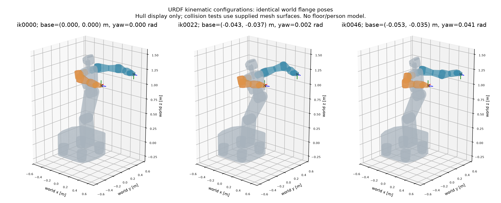
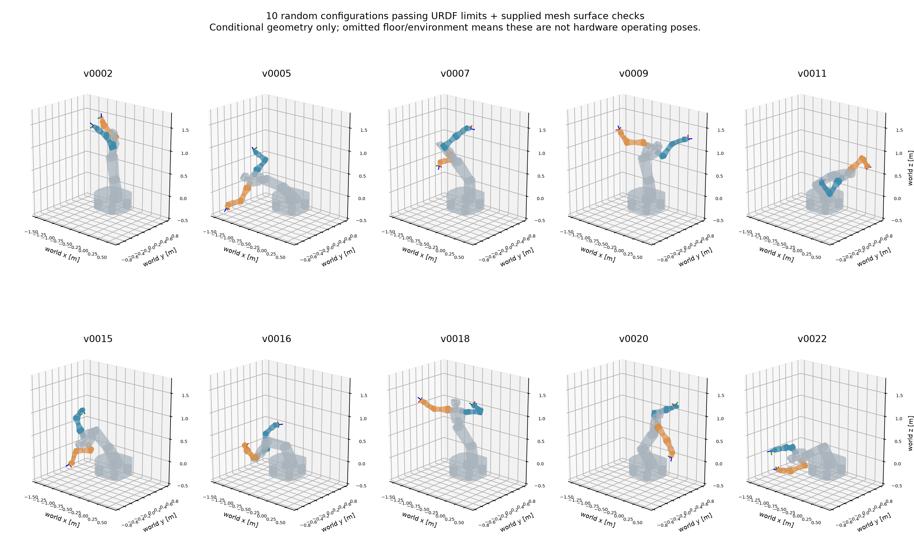
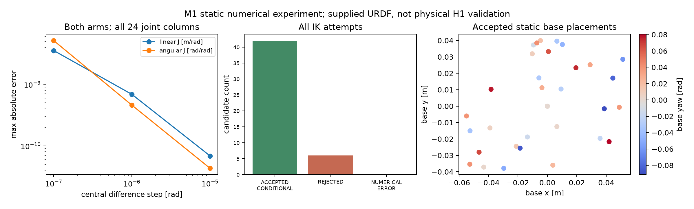

# M1-B：双臂运动学与冗余配置验证

日期：2026-11-11。完成范围是**提供的URDF内的静态几何建模**，不是经真机标定的H1运动学验证。资产存在第7轴方向/限位等冲突，详见 [M1_ASSET_AUDIT.md](M1_ASSET_AUDIT.md)。停在 M1-A/B，不开展动态施力、MPC、RL、VLA、接触仿真或真机控制。

## 源码、环境与复现

分支 `m1/asset-kinematics`，基于已审阅 M0 提交 `d6ede91783c71da8cf5e5f064db3d42640eed225`。
数值实现初始提交 `3b4053c`，正式数值源码提交 **`090092edb1798cdb1382c91c22bf7b199aada321`**；该次运行 tracked 工作区干净。后续报告/重放/绘图工具提交 `02215df883745678ef658d99fe38c0b97d9be355`。完整数据与报告交付提交见本轮 Git 历史（不把文档自引用哈希写入自身）。

Python 3.11.15，Linux-6.8.0-138-generic-x86_64-with-glibc2.35。主要依赖：mujoco 3.10.0, python-fcl 0.7.0.11, trimesh 4.12.2, numpy 2.4.6, scipy 1.17.1, matplotlib 3.11.0, pyyaml 6.0.3, pytest 9.1.1。必要依赖锁定在 `requirements-m1.txt`；完整已安装包清单 `results/m1/environment_packages.json`。本机复用了 rl 环境中的MuJoCo/数值库和本地trimesh；仅补缺python-fcl wheel，不使用GPU、服务器或动态步进。

先按 `assets/h1/README.md` 将同一用户资产放在本地。新环境安装（可优先用现有本机环境/缓存）：

```bash
python3.11 -m venv .venv-m1
env -u PYTHONPATH .venv-m1/bin/python -m pip install -r requirements-m1.txt
env -u PYTHONPATH .venv-m1/bin/python -m pip install -e . --no-deps
```

本次实际运行：

```bash
env -u PYTHONPATH .venv-m1/bin/python -m pytest -q
env -u PYTHONPATH .venv-m1/bin/python -u -m h1_kinematics --config configs/m1_kinematics.yaml --output results/m1/run --seed 20261111
env -u PYTHONPATH .venv-m1/bin/python -m h1_kinematics.plots results/m1/run
env -u PYTHONPATH .venv-m1/bin/python scripts/validate_m1.py results/m1/run
.venv/bin/python scripts/verify_frozen_exp0.py --output results/m1/frozen_exp0_integrity.json
```

重现时把 `--output` 改为新的空目录（如 `results/m1_reproduction`），绘图/重放也使用新目录。程序拒绝覆盖既有非空实验目录。`env -u PYTHONPATH` 是为隔离本机ROS Humble的Python3.10路径。运行记录 `results/m1/run.log`、`pytest.log`、`replay.log`、`plots.log`。原始EXP0的48个哈希核对全通过，未覆盖原数据；终端判据与重放含义见 [M0_REVIEW_ADDENDUM.md](M0_REVIEW_ADDENDUM.md)。

## 数学模型与约束

对每条树边，`T_parent,child(q)=T_origin R_axis(q)`，沿树连乘；固定关节不加旋转。库为MuJoCo 3.10.0的URDF导入、`mj_kinematics`、`mj_comPos`、`mj_jacBody`。内存适配仅移除visual/collision并禁用fixed体融合以保留全部frame；原始关节和惯性字段不修改，独立保存在 `kinematics_only.urdf`。MuJoCo编译器会作其内部表示转换；没有用它推断或验证惯性，也没有调用forward/step或设置控制器/执行器。

世界坐标系定义为参考 `base_link` 坐标系，SI、右手系；静态底盘变量 `b=[x_b(m),y_b(m),yaw(rad)]`，`z=roll=pitch=0`。world z=0 **不是地面**。手册支持全向3DOF的产品声明，但现URDF缺转向/驱动映射，因此这里只枚举静态摆放，不能解释为瞬时自由漂移、可执行路径或动力学可达性。

q按 `configurations.npz/joint_names` 的24个URDF转动关节排序，单位rad。IK优化 `1-Joint…4-Joint` 与双臂14个关节，共18个关节；轮角和 `5-Joint/6-Joint` 固定为0。每次IK的底盘摆放固定，由外层采样；同一目标也有12次固定零底盘的多起点尝试。搜索盒 x±0.06 m、y±0.04 m、yaw±0.10 rad，只是数值实验采样域，不是厂家行程/速度限值。

左右虚拟扶手均与其法兰取恒等变换。固定共同目标由YAML中明确的参考q正运动学生成：

- 左位置：`[0.6271839, 0.4019104, 1.204832] m`。
- 右位置：`[0.6271839, -0.4019027, 1.204832] m`。

完整两个4×4目标（**含朝向**）及参考q见 `targets.json`，在所有候选间不改变；左/右自然是不同位置，要求是每一侧在不同机器人配置下保持同一世界位姿。没有为增加成功率逐样本改变目标。

双臂残差为 `e_i=[p_i-p_i*, 0.25 Log(R_i R_i*ᵀ)]`，用有界SciPy TRF least-squares最小化两个残差平方和。Log为世界表达旋转向量，0.25 m是位置/旋转残差的数值权重，不是机器人尺寸或物理阻抗。求解器用三点数值导数；主残差评估预算160次，`ftol=xtol=gtol=1e-10`；SciPy的nfev不含全部数值Jacobian额外函数调用。

后验独立按每侧位置2范数≤1e-5 m、SO(3)角度≤1e-5 rad、原URDF关节限位（1e-10 rad数值容差）、所附mesh表面间隙≥0.002 m筛选。所有试次保存初值、最终q、base、solver原始status/message/nfev、误差、碰撞对/间隙、筛选原因和时间。连续运动路径、环境碰撞、重力/稳定性与厂家真实动态限制不在此判据。

雅可比按 `[world linear; world angular]` 排列。每侧完整J是6×24，臂自身子块6×7；每侧上游4个编号关节参与，另一臂、轮与末端无关分支的列为零。FK与独立按原URDF变换连乘交叉核对；J用中心差分：位置 `(p(q+ε)-p(q-ε))/(2ε)`、角速度 `Log(R(q+ε)R(q-ε)ᵀ)/(2ε)`。检查所有24列，无base导数（base摆放是外层变量）。`jacobians.npz` 保存10个合格随机样本的完整与6×7子块，线性部分单位m/rad，角度部分rad/rad。

碰撞检查详见审计报告：55对安装拓扑排除、441对检查；凸包可分离时用其下界，接近时用原三角表面复核。`min_distance_m`混合保守凸包距离下界及复核表面距离，不能宣称是全模型精确最小净空；相交时-1是哨兵而非穿透深度。部分mesh开口，因此 **ACCEPTED_CONDITIONAL** 仅表示该已声明几何约束检查通过，不是完整实体无碰撞证明。碰撞只做后验筛选，不是IK连续约束优化。

## 自动测试与实际数值

`pytest` **48 passed**，包括原M0的41项和M1的7项。M1覆盖资产完整性/mesh解析、保留源惯性、FK独立实现、双侧J及非作用列、碰撞与间隙的负例、改变base后的双臂IK、不可达目标的局部失败/输入与限位检测、不可变导入及损坏文件检测。单元测试中的负例不是主实验数据。

固定seed=20261111：全URDF关节限位内均匀随机采样18个选定关节，共试 23 次，得到10个所声明条件内合格样本，另13个筛除（13个有表面相交，其中1个也有其他pair间隙不足，原因可重叠）。采样在得到10个合格样本后停止（预算250次），不是固定样本量的物理成功率估计。轮/5/6关节固定0，未采样全部硬件状态，也无地面，因此图中某些低位姿态不能作为实机工作姿态。

10个合格样本分别检查3种差分步长，原始30行在 `differential_checks.json`。独立FK全34个frame的最大位置差 1.13220977e-15 m，最大SO(3)角差 6.32004527e-16 rad。

| ε [rad] | max |ΔJ_linear| [m/rad] | max |ΔJ_angular| [rad/rad] |
| --- | --- | --- |
| 1e-05 | 6.84502455e-11 | 4.3023602e-11 |
| 1e-06 | 6.87560231e-10 | 4.58585836e-10 |
| 1e-07 | 3.54996388e-09 | 5.15537324e-09 |

48个双臂多起点IK，42个 **ACCEPTED_CONDITIONAL**、6个 **REJECTED**、0个数值异常；42个关节配置之间最小18维L2角距离 0.340258351 rad，包含 32 种不同静态base（其中11个合格样本base=0，另31个base不同）。不只是重复保存同一q。

合格样本最大每侧位置误差 **1.83634109e-08 m**，最大姿态误差 **1.09929371e-07 rad**。这是数值误差，不是真机精度（手册重复定位指标不与之等同）。正式程序墙钟 22.341244 s，包含资产审计、随机检查与搜索，不含启动/后续绘图/重放。计时依赖本机负载，不能当实时控制性能。

局部求解41次status=1（gtol），7次status=0（预算耗尽）；其中1次预算耗尽但已满足几何误差要求，按后验判据通过；其余6次均因目标位置和朝向超差筛除。没有把“局部超预算未达标”写成“全局IK不可行”。

| candidate | solver status | nfev | max position [m] | max rotation [rad] | filter reasons |
| --- | --- | --- | --- | --- | --- |
| ik0009 | 0 | 160 | 0.000222048494 | 0.00122908901 | target_position; target_orientation |
| ik0025 | 0 | 160 | 0.00249860647 | 0.0132947961 | target_position; target_orientation |
| ik0030 | 0 | 160 | 0.00020673663 | 0.00100423648 | target_position; target_orientation |
| ik0035 | 0 | 160 | 0.000165443491 | 0.000924906035 | target_position; target_orientation |
| ik0044 | 0 | 160 | 2.19955391e-05 | 0.000145092297 | target_position; target_orientation |
| ik0047 | 0 | 160 | 0.000918338345 | 0.00498796521 | target_position; target_orientation |

保存后71个记录（48候选+23随机）重新检查，状态/原因不符=0；NPZ/JSON完全一致。这是同一模型的重放一致性，不是物理验证。离线静态IK没有扰动/反馈信息，不构成EXP0的因果控制验证或H1恢复边界结果。

## 图与原始数据

所有图来自真实保存的q/误差/状态；机器人图用原始mesh的凸包简化显示，碰撞检测的三角复核与图形显示不是一回事。不存在人体或硬件实验曲线。







- `asset_audit.json`：逐link/joint/mesh、所有源文件哈希。
- `targets.json`, `config.yaml`, `metadata.json`：目标、参数、seed、源码、依赖。
- `candidates.json/.csv`, `configurations.npz`：全部48个候选、初值、结果及筛选原因。
- `random_validation.json`, `differential_checks.json`, `jacobians.npz`：全部随机尝试、30个差分检查及10组双臂J。
- `collision_policy.json`, `replay_validation.json`：全部检查/排除pair与理由、保存后的一致性。
- `results/m1/development/`：真实开发诊断，独立于正式结果。
- `results/m1/frozen_exp0_integrity.json`：原EXP0产物48项哈希均保持。

## 实际失败、局限与审阅关口

首次启动时实验和测试并发解压同一目录，导致读取未写完的二进制STL（header长度1866400、读取262060），导入失败；完整栈保留在 `development/first_run_asset_read_error.log`。这是资产读取失败，未产生有效实验样本。提交090092e使既有文件校验复用、不再重写，新文件完整写入后原子发布；添加损坏/重复导入测试。修复后正式运行使用新空目录。不是通过添加猜测参数或放宽约束修复。

初版单凸包检查在双侧腕link5/link7产生误报；`development/hull_false_positives.json` 保存实际凸包碰撞而三角表面不相交、约6 mm间隙的结果。最终使用三角复核且保留2 mm条件；没有为好看而关闭该pair。最终随机筛选的13次碰撞拒绝和IK的6次超差拒绝均完整保存。

仅完成文件审计和URDF内静态几何验证。第7轴语义冲突意味着**不能把本次IK/J结果直接作为经确认的H1真机结果**。没有匹配当前施力余量、没有动态响应或恢复能力比较。G0/G1维持用户已限定的M0审阅结论，G2（真实H1配置恢复差异）与G3（创新/强基线优势）仍未验证。

下一步最小任务是审阅本报告及资产冲突，优先向厂家核实第7轴、模型版本、惯性、舵轮与关节参数；本轮在这里停止，等待用户/研究助手审阅，不自行进入动态施力建模。待确认信息清单见资产审计末节，无需4×4090服务器。
