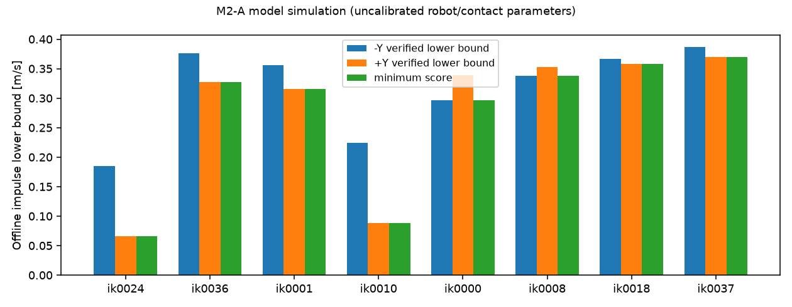
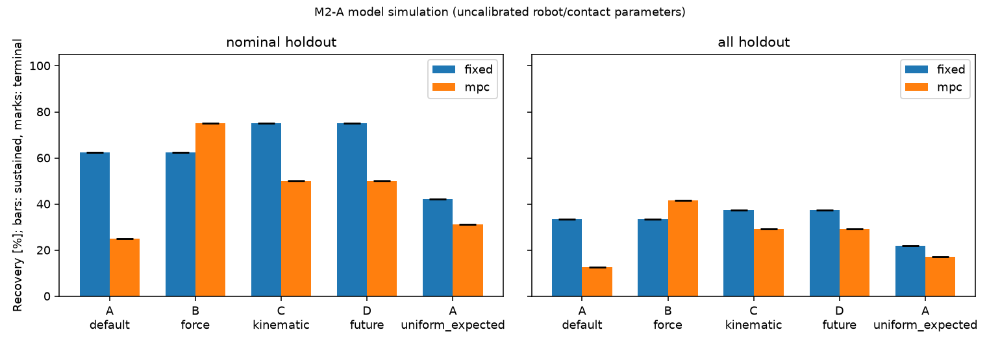
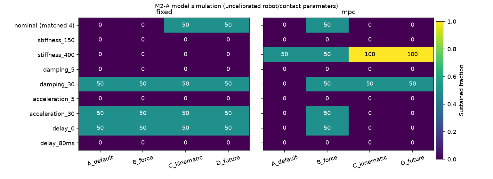
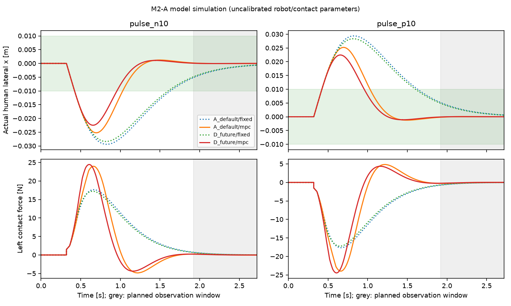

# M2-A：未来恢复评分与初始全身配置选择

**结果：本轮没有证明未来评分的独立算法优势。** D与瞬时运动学C都选ik0037；MPC下D主持续率29.17%，默认A为12.50%，力矩代理B为41.67%。若只看人体状态，D为52.08%、A为50.00%、B为79.17%。评分与提前选姿态有条件性价值，仍受到局部搜索、在线曲线与控制目标的明显影响。

本轮是未标定人体—H1 模型内的方法验证，不是硬件实验。独立测试采用预先冻结的选择；不使用离线已知扰动轨迹替代闭环控制。M0/M1-B/M1-C/M1-D 的源码与冻结数据均保留，M1-D 原 399 条接受轨迹的判定没有修改。

## 实施与来源

- 分支：`m2/posture-selection`；起点 `8b818aeac891ff39501953ae95b62e2b7387d559`。
- 评分前源码/预定义配置：`a828c5a`；正式评分 provenance 指向该提交。
- 正式选择及闭环计算源码：`5716852`；后续提交仅增加分析、诊断日志与断点恢复保护，没有改变运行中的控制器、物理模型或测试参数。每阶段实际 SHA 见 `results/m2a/*_provenance.json`。
- 新模块：`src/h1_selection/`，配置 `configs/m2_posture.yaml`，详细方程/单位/训练测试划分见 [预定义模型与协议](M2_POSTURE_SELECTION_MODEL.md)。
- CPU：本机 Intel Core Ultra 7 155H，4 个进程，每进程 BLAS/OMP 线程数 1；没有 GPU 仿真，也没有下载资产或依赖。
- Python 3.11.15；NumPy 2.4.6、SciPy 1.17.1、Matplotlib 3.11.0、PyYAML 6.0.3、pytest 9.1.1、MuJoCo 3.10.0、trimesh 4.12.2、python-fcl 0.7.0.11、CasADi 3.7.2（自带 OSQP 0.6.3）。锁定版本见 `requirements-m2.txt`。

## 模型与判定

复用 M0 LIPM、M1-C FK/J/机器人约束、M1-D 被动接触与直接关节优化/独立重放。人体 `70 kg, 1 m`，每手向上支撑 `30 N`；每手横向接触 `f_i=k(h_i−x)+c(hdot_i−v)`，名义 `k=250 N/m, c=15 N·s/m`，合力上限 `80 N`。扶手实际位置/速度由 FK/J 得到，驱动人体 ODE，再将实际人体状态反馈给控制器。没有把最大扶手位移当作最大力。

机器人名义预算及 `15 rad/s², 40 ms` 来自研究叠加配置，未标定为真实 H1 动态能力。共享躯干各 `100 N·m` 的接触载荷累加；机器人重力、惯性力矩与底盘抗倾覆不在模型中。执行中底盘和躯干固定；候选初始底盘位姿可不同，所有候选初始双扶手世界位姿相同至 IK 容差。初始配置切换的可执行性和时间不建模。

关节位置/速度也使用M1-C已声明的研究叠加配置，具体各关节数值见模型文档；位置范围覆盖原URDF范围，不能解释成未经覆盖的URDF限位或本轮新获得的厂商参数。原URDF及旧模块未修改。

主终端箱为 `|x|≤0.01 m, |v|≤0.03 m/s, |y|≤0.005 m, |w|≤0.02 m/s`，时刻是环境最后扰动后 `1.6 s`。随后同一因果控制器、同一队列继续 `0.8 s`；持续成功要求整个观察窗均在箱内、轨迹完整、验证通过。终端成功也要求已记录轨迹约束验证通过。全过程人体范围 `|x|≤0.20 m, |v|≤2 m/s`。恢复时间需进入后保持到观察结束、至少停留 `0.2 s`。目标箱不是可控不变集；有限观测不是永久稳定证明。

## 离线评分与实际选择

每配置每方向直接优化 14 关节加速度，统一 `1.6 s / 40 ms`、幅值上限 `0.5 m/s`、三个初值、每初值 24 次迭代、信赖域 `0.015 rad`。评分仅用初态静止、t=0 的单次已知方向扰动。找到的轨迹必须通过真实 FK、被动接触、独立人体积分、预算与采样碰撞检查。R 是两方向已验证幅值下界的最小值，不是全局/硬件最大值，也不保证所有较小幅值都可恢复。

| 配置 | R− [m/s] | R+ [m/s] | R [m/s] | 力矩代理 [N] | 瞬时速度 [m/s] |
|---|---:|---:|---:|---:|---:|
| ik0024 | 0.185424 | 0.065729 | 0.065729 | 157.095345 | 0.682282 |
| ik0036 | 0.376641 | 0.327091 | 0.327091 | 171.285158 | 1.496749 |
| ik0001 | 0.356362 | 0.315913 | 0.315913 | 169.656128 | 1.428962 |
| ik0010 | 0.224947 | 0.088787 | 0.088787 | 162.091285 | 0.874230 |
| ik0000 | 0.296939 | 0.339019 | 0.296939 | 168.066615 | 1.354972 |
| ik0008 | 0.338626 | 0.352915 | 0.338626 | 206.767848 | 1.155420 |
| ik0018 | 0.366630 | 0.358521 | 0.358521 | 246.306000 | 1.247307 |
| ik0037 | 0.387306 | 0.369462 | 0.369462 | 174.419169 | 1.684667 |

完整数据：`results/m2a/directional_scores.json`、`candidate_metrics.csv`、`score_cases/`、`score_iterates/`、`score_paths/`。1152 个线性化子问题均返回最优，1152 个候选迭代均通过主重放；没有把失败结果画成成功。48 个初值中有 8 个重复：ik0024、ik0010 的两个方向均因曲线种子不可行，退回零种子，所以不能把它们称作三次独立探索。

初始化影响可观：ik0037 的正方向零初值下界为 `0.333432 m/s`，加入两种曲线种子后为 `0.369462 m/s`；ik0018 为 `0.301094 → 0.358521 m/s`。本轮 ik0036 的 `R+=0.327091` 也低于 M1-D 特定暖启动找到的约 `0.360867 m/s`。这是局部搜索证据依赖初值，不是机器人能力发生退化。

扩展八配置的选择：A 默认 ik0001；B 未截断名义力矩代理 ik0018；C 瞬时运动学 ik0037；D 未来评分 ik0037。原四配置中，B/C/D 都选 ik0036。扩展同时改变了 B/C/D 的候选，不能把候选扩展收益都归于 D。

每手横向接触上限为 `74.161985 N`，合计 `148.323970 N`。截断后八个配置的当前施力指标全部并列；B 的区分来自截断前的名义力矩代理，不代表实际接触裕度不同。额外报告并列时按候选顺序选择 ik0024 的 `B_capped_order_tie`，以及均匀随机期望和固定种子的随机抽取；不能声称 B 是具有不同真实支撑力的硬件强基线。

C 与 D 本轮选择完全相同，所以两者闭环结果必然完全相同。本轮即使 D 超过默认或随机，也不能证明未来评分比瞬时运动学指标更有独立方法价值。

## 因果控制与独立测试

保留 M1-D 固定反馈；新增统一的局部扶手运动 QP MPC，时域 `2 s`、周期 `40 ms`、同一代价与约束生成原则。各配置从两种空间曲线与六个域中，用初始几何的 `V*A*域宽` 选控制曲线；不读测试结果或未来评分。MPC 预测未知未来外扰为零，仅输入当前实际人体/机器人状态与已提交命令队列；没有环境日程、案例编号、离线恢复轨迹或终端时刻参数。

所有方法使用相同控制器、模型、参数与计算预算。OSQP 每次最多 6000 迭代，精度 1e−7；该后端不支持可中断墙钟超时，30 ms 仅为诊断目标。QP 不可用时显式回退同一个 governor；两者均无法给动作则截断并计失败，不等价于机器人全局不可恢复。仿真没有把计算超周期变成额外执行延迟，因此不证明实机实时性。

评分/选择在测试前冻结。名义 16 种场景，包括延迟脉冲、多初速度和两次反向脉冲；另有八个单因素条件各 4 种场景，变化接触刚度、阻尼、关节加速度及控制延迟，共 `48 × 8 × 2 = 768` 次。控制器知道当前接触参数；不把参数条件变化实验称作未知参数鲁棒性。所有方法共用同一场景表。幅值仍处于同一研究范围，独立性来自未用于挑选的时序/初态/组合，并非分布外泛化。

## 真实运行的闭环结果与消融

| 方法（选中配置） | 控制器 | 名义16场景主持续率 | 全48场景主持续率 | 全48人体-only持续率（事后诊断） |
|---|---|---:|---:|---:|
| A_default (ik0001) | fixed | 62.50% | 33.33% | 37.50% |
| B_force (ik0018) | fixed | 62.50% | 33.33% | 37.50% |
| C_kinematic (ik0037) | fixed | 75.00% | 37.50% | 41.67% |
| D_future (ik0037) | fixed | 75.00% | 37.50% | 41.67% |
| A_seeded_random (seeded) | fixed | 37.50% | 22.92% | 27.08% |
| A_uniform_expected (uniform) | fixed | 42.19% | 21.88% | 25.00% |
| A_default (ik0001) | mpc | 25.00% | 12.50% | 50.00% |
| B_force (ik0018) | mpc | 75.00% | 41.67% | 79.17% |
| C_kinematic (ik0037) | mpc | 50.00% | 29.17% | 52.08% |
| D_future (ik0037) | mpc | 50.00% | 29.17% | 52.08% |
| A_seeded_random (seeded) | mpc | 37.50% | 20.83% | 43.75% |
| A_uniform_expected (uniform) | mpc | 31.25% | 17.19% | 36.72% |

每个固定选择方法在每控制器下实际评估相同 48 场景；名义子集 16 场景。均匀随机是八候选结果的精确期望，不是额外采样试验；固定种子随机的实际配置逐场景保存在 `test_plan.json`。终端成功率与主持续成功率本次相同：全部 768 次中主终端成功 150 次，均保持到额外 0.8 s 观察结束。不能据此推断终端箱不变性。

在 48 场景上、保持固定反馈不变，D 相对 A 为 `18/48 vs 16/48`（+4.17 个百分点），相对 B 同样 +4.17 个百分点。保持 MPC 不变，D 相对 A 为 `14/48 vs 6/48`（+16.67 个百分点），但相对 B 为 `14/48 vs 20/48`（−12.50 个百分点）。D 与 C 为同一配置，差值严格为零。成对结果见 `summary.json:paired_posture_ablation`，没有因场景抽样不同造成的比较偏差。

**不能把主指标提高直接解释为人体恢复提高。** 原主定义还要求扶手回位。本轮事后诊断将这两个条件分开，但不更改主判定：名义 MPC 下，A 与 D 的人体-only持续率都是 `12/16=75%`；全48场景为 A `24/48=50%`、D `25/48=52.08%`，只多 1 个场景；B 为 `38/48=79.17%`。固定反馈下人体-only为 A `18/48`、D `20/48`。因此在更具预测结构的控制器下，没有获得有说服力的额外人体恢复优势；D 的主指标收益相当部分来自扶手回位。

控制器消融也没有显示 MPC 全面更强：固定 D 时，主持续率由固定反馈的 `37.50%` 降至 MPC 的 `29.17%`，但人体-only由 `41.67%` 升至 `52.08%`。固定 B 时，主指标由 `33.33%` 升至 `41.67%`。这里实现的是更具约束预测结构的基线，尚不能称为经验表现占优的强控制器；预设代价、有限恢复截止条件和求解可靠性都有影响。测试后没有据此修改代价或重新挑选配置。

## 失败、持续观测与数值记录

768 条已记录前缀全部通过主模型/几何验证，**只有 283 条完成整个仿真窗**，其余 485 条控制器提前停止。通过前缀验证不等于恢复成功。完整轨迹中，150 条主恢复、87 条人体在箱内但扶手回位条件未满足、46 条人体终端条件未满足；没有观察到“主终端已恢复但在0.8 s内再次离开箱”的案例。控制器停止分为固定 governor 无可执行动作 246 次、MPC 与 fallback 均不能给出动作 239 次。它们是此控制器/曲线类的失败，不是机器人全局不可恢复的证明。

离线评分 1152 次子问题与主重放均接受；在线 MPC 共 13405 次调用，11373 次 `solved`，1861 次达到迭代上限，171 次 `solved inaccurate`，后两类均显式回退，共 2032 次。达到迭代上限是数值/预算下的未知，不能记作已证不可行。没有隐藏丢弃这些尝试。详见 `cases/*:command_logs` 和 `outcome_diagnosis.json`。

MPC 调用墙钟耗时：中位 `1.552 ms`，P95 `66.624 ms`，P99 `71.861 ms`，最大 `99.315 ms`；2378/13405 次超过 40 ms（约17.74%）。计时发生在4个CPU进程并行的实验中，不是硬实时测试。仿真仍使用预定0/40/80 ms控制延迟，没有把计算迟到叠加到动力学，因此闭环结果对真实计算延迟可能偏乐观。OSQP 内部迭代次数接口未暴露时记为 null；统一6000迭代预算仍由求解器设置实施。

主数据的环境人体积分与单独执行的实际 FK/接触 DOP853 重放，最大状态差 `1.139e−13`（分别按 m / m/s）；最大扶手位置协调误差 `3.524e−8 m`、旋转误差 `2.077e−8 rad`；初始候选间扶手位置差 `3.545e−10 m`。这属于同一物理模型内的数值一致性，不能代替物理标定或硬件验证。

后续独立检查复算全部768条的终端/持续判定、力/力矩/关节/底盘与延迟队列，无差异。16条最佳评分轨迹用2.5 ms、mesh 10 ms重放均通过；另16条闭环轨迹包含8条完整恢复并覆盖0.8 s观察窗，以及8条强扰动截断失败前缀，均通过加密约束复核。验证代码和结果见 `src/h1_selection/audit.py`、`audit.json`、`dense_audit/`。依然没有连续碰撞证明或终端不变集证明。

为检查预算受限求解的可复跑性，另在 `repeatability/` 保存36个相同参数案例：A/B/D三姿态、±0.10/±0.18/±0.26 m/s、两控制器、仍用4进程。36/36的主判定、完整性、长度和fallback次数一致，共同节点状态与送达控制的最大差均为0；计时不要求一致。这是对已用场景的数值复跑核验，不是新增独立泛化证据，没有替换主结果。

## 约束机制与参数敏感性

固定反馈与MPC均没有人为给某个配置更大的驱动参数。名义在线曲线：ik0024只允许±0.01 m、0.074 m/s、0.891 m/s²；A/ik0001为±0.08 m、0.278 m/s、2.189 m/s²；D/ik0037为±0.08 m、0.405 m/s、2.983 m/s²。相同物理预算经不同关节几何、曲率与限位映射后，形成不同的受限运动能力，再通过被动接触改变实际力时序。

已记录的名义MPC轨迹中，多个配置达到曲线速度上限和约99.7%的域边界，而关节加速度利用约0.60–0.80，接触力矩/合力仍有余量。全部已记录段最大人体偏移 `0.1283 m`、每手横向力 `62.72 N`、接触力矩预算比 `0.7085`。这些是截断前的观察量，不能据此声称失败时没有其他潜在限制或人体会永久保持在安全范围。

B/ik0018在线曲线允许±0.12 m、0.505 m/s、2.820 m/s²，比D具有更大运动域/速度，尽管本轮直接优化评分略低。这与其MPC恢复表现更好一致。评分使用可改变冗余关节运动的14关节直接优化，在线却被限制在预选的一条空间曲线上；两种控制类不一致，是离线评分未转化为稳定闭环排序的主要混杂因素之一。不能把曲线搜索器的保守性当作H1固有能力。

敏感性图使用名义集里相同±0.18/±0.26 m/s四个场景作基准，**没有把名义16场景比例与敏感性4场景比例直接作参数因果比较**。接触变软/低阻尼、低加速度、80 ms延迟条件下，本测试集合主成功率很低或为零；刚度400 N/m时，MPC下D可达4/4而固定反馈为0/4；加速度30 rad/s²并未自动改善MPC主成功率。闭环启发式策略与截止目标不具有对预算的单调成功率保证，不把这些失败当作真实物理不可恢复。完整条件表见 `policy_summary.csv` 中 `nominal_matched_sensitivity` 及各variant行。

为公平比较人体偏移，另在所有四种选择均完整且合法的共享场景上配对：固定反馈共24场景，A/B/D平均峰值为 `0.05216/0.04956/0.04918 m`；MPC共25场景为 `0.05077/0.04335/0.04564 m`。它们仍是条件子集，不代表整个48场景总体。恢复时间只对主成功轨迹统计：全48条件D固定反馈平均 `1.428 s`、D MPC `1.442 s`，B MPC `1.441 s`（相对最后扰动；条件样本不同，不能单凭均值排序）。所有失败已观测峰值及null恢复时间保存在原始数据，没有补画未来轨迹。

## 五个研究问题的回答

1. **评分能否区分姿态？** 能区分本轮搜索到的可行轨迹，下界从0.0657到0.3695 m/s。与名义MPC主成功率的探索性Spearman相关为0.901；但仅8个有意抽样配置，含并列及控制曲线混杂，不是统计泛化或全局能力排序证明。名义未截断力矩代理的相关反而为0.951，瞬时运动学为0.451，不能据此挑选最有利的指标叙事。
2. **选择评分最高姿态能否提高未知扰动恢复？** 相比默认/随机有条件性主指标收益；固定反馈的额外人体恢复只有2/48，MPC只有1/48；MPC下还明显落后B。不能宣称跨控制器、跨条件稳定优越。
3. **相比当前施力与瞬时运动学，收益来自哪里？** 实际接触上限下当前施力全部并列，运动域、速度、加速度映射及接触力时序更有区分力。但D和C选同一姿态，故没有证明未来评分比瞬时指标有独立选择收益；B未截断代理也可能只是与有利几何相关。
4. **哪些结果受局部求解器影响？** 直接优化初始化显著改变下界，8个种子重复；在线曲线充分界缩小动作类；QP迭代上限/回退影响闭环结果；软代价不保证按1.6 s完成扶手回位。所有下界、失败与排序都需在这些条件下解读。
5. **是否现在引入在线全身优化或能力近似？** 尚不足以支持立即投入复杂在线全身优化或训练新能力模型。最小后续任务应先在训练集内确定可靠的因果控制/扶手回位规则，再对齐评分与执行的动作类（例如少量曲线或局部关节自由度），用新的独立测试集复核。若仍能超过瞬时指标，再考虑近似评分的计算收益。当前CPU MPC已有超周期，不能直接假定14关节在线优化可实时。

本轮对“未来评分具有独立算法优势”给出 **尚未通过** 的结论；对“统一模型内的提前配置选择可以改变闭环恢复结果”给出有限支持。停止于M2-A，等待审阅，不开展新阶段。

## 交付、图表与复现

- 原始配置/版本/来源：`results/m2a/config.yaml`、`metadata.json`、各stage provenance。
- 离线原始数据：`score_cases/`、`score_iterates/`、`score_paths/`；所有已接受和中间候选均保留。
- 闭环原始数据：`test_plan.json`、`test_selection_freeze.json`、`selection.json`、`closed_loop.json`、`cases/`、`paths/`。NPZ包含实际/理想人体状态、实际接触力与力矩、扶手、关节、底盘及约束量。
- 汇总：`policy_summary.csv`、`candidate_rates.csv`、`all_candidate_rates.csv`、`case_summary.csv`、`constraints_by_candidate.csv`、`paired_complete_peak_summary.csv`、`outcome_diagnosis.json`、`summary.json`。
- 8组PNG/PDF图：双方向评分、初始化、选择/控制器消融、匹配敏感性、评分与闭环、强扰动失败轨迹、轻扰动完整轨迹、约束利用。均为实际模型仿真数据，不是实物实验。轨迹停止处即停止记录；灰色是计划观察窗，失败后的空白没有补值。
- 自动测试和冻结校验见 [M2测试报告](M2_TEST_REPORT.md)。M0至M1-D的7058项冻结文件均匹配，旧数据与旧模块未改。









运行命令（仓库根目录；复用现有环境/资产，无需下载）：

```bash
export OPENBLAS_NUM_THREADS=1 OMP_NUM_THREADS=1
env -u PYTHONPATH .venv-m1/bin/python -m pytest -q
# 全量复现使用新目录，避免覆盖交付数据：
env -u PYTHONPATH .venv-m1/bin/python -m h1_selection.experiment --output results/m2a_reproduction --stage prepare
env -u PYTHONPATH .venv-m1/bin/python -m h1_selection.experiment --output results/m2a_reproduction --stage score --workers 4
env -u PYTHONPATH .venv-m1/bin/python -m h1_selection.experiment --output results/m2a_reproduction --stage select
env -u PYTHONPATH .venv-m1/bin/python -m h1_selection.experiment --output results/m2a_reproduction --stage test --workers 4
env -u PYTHONPATH .venv-m1/bin/python -m h1_selection.experiment --output results/m2a_reproduction --stage analysis
env -u PYTHONPATH .venv-m1/bin/python -m h1_selection.audit --output results/m2a_reproduction
# 可选的独立目录复跑核验（不覆盖主数据）：
env -u PYTHONPATH .venv-m1/bin/python -m h1_selection.repeatability --output results/m2a_reproduction --workers 4
# 只读核验交付文件：
env -u PYTHONPATH .venv-m1/bin/python -m h1_selection.experiment --stage verify
```

恢复评分依赖局部搜索与数值环境，重新运行不承诺逐比特一致；CPU计时尤其不可逐值复现。断点续跑要求相同配置和源码语义，修改算法请换新目录。允许厂家/用户补充真实驱动、躯干、底盘与接触参数后再另行验证；本轮没有待确认参数被擅自当作真实值使用。
